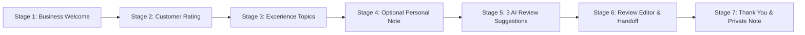
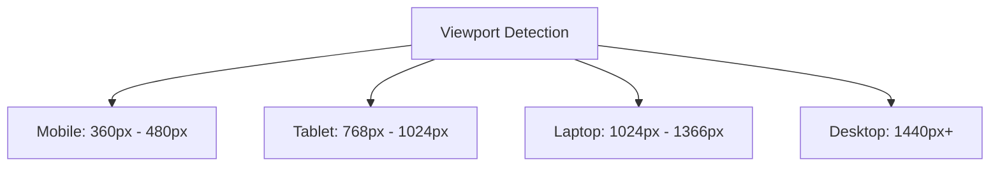

# VRAJA AI — PRODUCT A (REVIEW STUDIO)
# RESTAURANT DYNAMIC TEMPLATES: ARCHITECTURAL DESIGN SPECIFICATION
**Document Version:** 1.0.0 (Design Planning Phase)  
**Status:** **DESIGN SPECIFICATION ONLY — NO CODE MODIFICATIONS APPLIED**  
**Target Domain:** Restaurant Industry (Product A)  
**Protected Products:** Product B (Digital Card) & Production Backend Core  

---

## 1. Executive Summary & Protection Guarantee

This document defines the architectural and visual composition specifications for **four distinct Restaurant presentation templates** within VRAJA AI Product A (Review Studio / NastaGhar):

- **R01 — Classic Bistro** (Elegant, warm, traditional, trustworthy)
- **R02 — Modern Urban** (Bold, energetic, compact, high-efficiency)
- **R03 — Luxury Dining** (Sophisticated, premium, minimalist, deliberate)
- **R04 — Café & Playful** (Friendly, warm, conversational, approachable)

### Strict Project Protection Mandates
1. **Zero Source Code Alterations:** In compliance with the Master Prompt, this phase delivers **architectural design specifications and design planning only**. No source code, dependencies, routes, or database records have been altered.
2. **Product B Isolation:** Product B (`Digital_Card/**`) remains strictly untouched, unreferenced, and read-only.
3. **Unified Engine Integrity:** All four templates utilize the **identical customer review journey and single shared review engine** (language detection, sentiment analysis, AI prompt grounding, idempotency, anti-gating, and clipboard handoff). Presentation templates vary exclusively in layout composition, visual hierarchy, typography, component styling, and motion design.

---

## 2. Shared Customer Journey & Engine Contract

Regardless of which restaurant template is rendered, every diner traverses an identical 7-stage experience:



### Invariant Business Rules Across All Templates
1. **Google Anti-Gating Policy:** Every customer who inputs a rating (1 to 5 stars) receives unconditional, immediate access to the Google Maps review handoff. Negative feedback is never hidden, restricted, or forced into private tickets.
2. **Trilingual Browser Detection:** Zero manual language pickers. Browser headers and navigator settings automatically route diners into **Gujarati (`gu`)**, **Hindi (`hi`)**, or **English (`en`)** with 100% UI consistency.
3. **Zero Fabrication AI Grounding:** AI suggestions generate strictly across three styles:
   - *Style 1:* **Short & Natural** (12–25 words, everyday conversational tone)
   - *Style 2:* **Detailed & Expressive** (35–55 words, sensory and specific)
   - *Style 3:* **Simple & Personal** (20–35 words, customer-note driven)
4. **Session-Scoped Draft Recovery:** 2-hour TTL localStorage draft recovery isolated strictly by `business_id`.
5. **Private Feedback Channel:** Optional direct-to-management messaging channel that never blocks or substitutes Google Review publication.

---

## 3. Four Restaurant Template Design Specifications

---

### TEMPLATE R01 — CLASSIC BISTRO

#### 1. Design Philosophy
Classic Bistro evokes the atmosphere of a heritage bistro, fine brasserie, or beloved multi-generational family dining hall. It emphasizes timeless craftsmanship, warm hospitality, and quiet confidence through classical typography, warm natural ivory tones, deep forest emerald accents, and hairline gold framing.

#### 2. Target Restaurant Category
- Traditional multi-cuisine restaurants
- Family heritage dining establishments
- Authentic regional eateries (e.g., traditional Gujarati Thali, Awadhi kitchens)
- Continental bistros & brassieres

#### 3. Complete Color Palette (HEX Tokens)
| Token Name | HEX Value | Visual Role |
| :--- | :--- | :--- |
| `--r01-bg-canvas` | `#FAF7F2` | Warm Parisian ivory page background |
| `--r01-surface-card` | `#FFFFFF` | Crisp architectural white content cards |
| `--r01-primary-emerald` | `#1B4332` | Deep heritage emerald for main headers and brand identity |
| `--r01-accent-gold` | `#C5A059` | Muted vintage gold for star lit states, borders, and emblems |
| `--r01-accent-gold-soft`| `#F3ECE0` | Soft cream champagne for badge backgrounds |
| `--r01-border-hairline` | `#E5DEC9` | Antique parchment hairline borders |
| `--r01-text-headline` | `#1A241E` | Deep charcoal-emerald for high-contrast legible headings |
| `--r01-text-body` | `#3D4A41` | Soft graphite for body copy and instructions |
| `--r01-text-muted` | `#7D8A80` | Subtle sage-gray for secondary metadata |

#### 4. Typography System
- **English Headings:** *Playfair Display* (Serif, weights 600, 700, letter-spacing -0.01em)
- **English Body / Controls:** *Lato* (Clean humanist sans-serif, weights 400, 500, 600)
- **Gujarati Fallback Stack:** `'Noto Serif Gujarati', 'Shruti', 'Gujarati Sangam MN', serif`
- **Hindi Fallback Stack:** `'Noto Serif Devanagari', 'Mangal', 'Kokila', serif`
- **Typographic Scale:**
  - Brand Header: `26px / 1.2`
  - Section Headings: `20px / 1.3`
  - Body & Options: `15px / 1.5`
  - Metadata & Badges: `12px / 1.4` (Uppercase tracking +0.08em)

#### 5. Component Composition (Stage-by-Stage)
- **Header:** Centered classic seal layout. Circular brand crest with 1px gold border. Business name set in elegant Playfair serif, subtitled by a centered gold ornament divider (`✦ ✦ ✦`).
- **Rating Component:** Classic 5-star row with 36px seriffed star outlines. Unselected stars feature `#D8CEBA` hairline borders; selected stars fill with warm luminous gold (`#C5A059`) with a subtle 4px radial glow. Centered Italian italic descriptor underneath (*"Truly delightful experience"*).
- **Topic Selection:** Editorial outlined chips. 2-column or 3-column balanced grid with 1px solid `#E5DEC9` borders, 8px border-radius. When selected, the background shifts to soft champagne (`#F3ECE0`) with `#1B4332` emerald text and checkmark indicator.
- **Personal Note Input:** Generous bordered text area with vintage inset shadow, placeholder text in italic Lato (*"e.g., The hand-rolled ravioli and saffron tea were sublime..."*).
- **AI Suggestion Cards:** Editorial review cards enclosed in double hairline borders (outer 1px `#E5DEC9`, inner 1px `#F3ECE0`). Clear style moniker header (*"Detailed & Expressive"* with quill icon). Generous 20px padding with balanced serif quotes.
- **Review Editor:** Centered editorial parchment block with live character counter in muted gold. Primary CTA: Deep emerald pill button with gold text (`"Copy & Continue to Google Maps"`).
- **Handoff & Private Feedback:** Centered modal with heritage crest illustration, 3-step numbered guide with Roman numerals (`I. Review Copied`, `II. Google Maps Opens`, `III. Paste & Post`).

#### 6. Layout Diagrams (Mobile & Desktop)

```text
[ MOBILE (390px) ]                     [ DESKTOP (1200px Dual-Column) ]
┌─────────────────────────┐            ┌──────────────────────────────────────────────┐
│       [Brand Crest]     │            │  [Brand Crest]                               │
│       Le Petit Bistro   │            │  Le Petit Bistro — Traditional Dining        │
│       ✦   ✦   ✦         │            ├──────────────────────┬───────────────────────┤
│                         │            │ LEFT: RATING & TOPIC │ RIGHT: AI REVIEW HUB  │
│  How was your visit?    │            │                      │                       │
│     ★ ★ ★ ★ ★           │            │  ★ ★ ★ ★ ★           │  ┌──────────────────┐ │
│  "Truly delightful"     │            │  "Truly delightful"  │  │ Short & Natural  │ │
│                         │            │                      │  │ "Authentic taste │ │
│  What stood out?        │            │  Highlights:         │  │  and warm team!" │ │
│ ┌─────────┐ ┌─────────┐ │            │  [✓ Food Quality]    │  └──────────────────┘ │
│ │✓ Taste  │ │ Service │ │            │  [✓ Staff Courtesy]  │  ┌──────────────────┐ │
│ └─────────┘ └─────────┘ │            │  [  Ambiance]        │  │ Detailed & Exp.  │ │
│                         │            │                      │  │ "The tasting...  │ │
│  Personal Note:         │            │  Personal Note:      │  └──────────────────┘ │
│ [The sauce was...]      │            │  [................]  │                       │
│                         │            │                      │  [Copy & Open Google] │
│  Review Ideas:          │            │                      │  ✦ Anti-Gating Valid  │
│ ┌─────────────────────┐ │            └──────────────────────┴───────────────────────┘
│ │ Detailed & Exp.     │ │
│ └─────────────────────┘ │
└─────────────────────────┘
```

---

### TEMPLATE R02 — MODERN URBAN

#### 1. Design Philosophy
Modern Urban is engineered for speed, high-energy dining, and fast-casual environments. It eliminates decorative fluff in favor of high-contrast brutalist-lite clarity, bold grotesque typography, tight vertical density, neon green feedback triggers, and tactile button controls optimized for single-thumb mobile operation.

#### 2. Target Restaurant Category
- Fast-casual restaurant chains
- Gourmet burger joints & taquerias
- Contemporary Asian noodle bars & bowl concepts
- High-volume craft pizzerias & urban food halls

#### 3. Complete Color Palette (HEX Tokens)
| Token Name | HEX Value | Visual Role |
| :--- | :--- | :--- |
| `--r02-bg-canvas` | `#0E1117` | Deep obsidian urban canvas |
| `--r02-surface-card` | `#181E29` | Dark metallic slate cards |
| `--r02-accent-volt` | `#10B981` | High-voltage signal green for active states & ratings |
| `--r02-accent-cyan` | `#06B6D4` | Electric cyan for secondary interactive focus |
| `--r02-border-grid` | `#263042` | Sharp technical border lines |
| `--r02-text-high` | `#FFFFFF` | Maximum brightness white for rapid scanning |
| `--r02-text-body` | `#CBD5E1` | Cool gray for descriptions |
| `--r02-text-dim` | `#64748B` | Monospace metadata and step indicators |

#### 4. Typography System
- **English Headings:** *Space Grotesk* (Bold grotesque, weights 700, 800, uppercase letter-spacing +0.04em)
- **English Body / Controls:** *Inter* (Geometric workhorse sans, weights 400, 500, 600, tabular figures)
- **Gujarati Fallback Stack:** `'Noto Sans Gujarati', 'Shruti', 'Gujarati MT', sans-serif`
- **Hindi Fallback Stack:** `'Noto Sans Devanagari', 'Mukta', 'Arial Unicode MS', sans-serif`
- **Typographic Scale:**
  - Brand Header: `24px / 1.1` (Bold uppercase)
  - Section Headings: `17px / 1.2` (Monospace prefix e.g., `// 02 HIGHLIGHTS`)
  - Body & Options: `14px / 1.4`
  - Technical Tags: `11px / 1.2` (Monospace uppercase)

#### 5. Component Composition (Stage-by-Stage)
- **Header:** Asymmetric left-aligned header. High-contrast square business logo tile with rounded technical corners (4px radius). Live table status badge in top-right (`TABLE #08 // DINE-IN`).
- **Rating Component:** 5 segmented block buttons rather than conventional stars. Each button features the numeric rating (`1` to `5`) and an electric LED-style star indicator. Selected rating lights up with neon signal green (`#10B981`) and displays an immediate reactive feedback chip (`[ 5.0 // EXCEPTIONAL ]`).
- **Topic Selection:** Wrapping horizontal technical pills with bold status indicators (`[+] Food Speed`, `[✓] Taste & Quality`). Zero emojis; high-contrast icons or technical indicators.
- **Personal Note Input:** Monospace input bar with rapid clear (`×`) button and live word count badge (`24/100`).
- **AI Suggestion Cards:** Compact stack cards with technical pill tags (`STYLE: DIRECT`, `STYLE: COMPREHENSIVE`). 1-click quick-copy button directly on card hover/focus without modal delay.
- **Review Editor:** High-efficiency dark code-inspired editor with syntax highlighting aesthetics. Primary CTA: Full-width vibrant green button with forward arrow (`"POST TO GOOGLE MAPS →"`).
- **Handoff & Private Feedback:** Direct sliding overlay with instant clipboard copy confirmation toast (`COPIED TO CLIPBOARD // OPENING MAPS IN 2S`).

#### 6. Layout Diagrams (Mobile & Desktop)

```text
[ MOBILE (390px) ]                     [ DESKTOP (1200px Multi-Column) ]
┌─────────────────────────┐            ┌──────────────────────────────────────────────┐
│ [IMG] SMASH BURGER CO.  │            │ [IMG] SMASH BURGER CO.   [TABLE 04 // DINE]  │
│ // 01 RATING            │            ├──────────────────────┬───────────────────────┤
│ [ 1 ][ 2 ][ 3 ][ 4 ][ 5*]│           │ // 01 EXPERIENCE     │ // 02 GENERATED REVIEWS│
│ [ 5.0 // EXCEPTIONAL ]  │            │                      │                       │
│                         │            │ [1][2][3][4][5*]     │ ┌───────────────────┐ │
│ // 02 HIGHLIGHTS        │            │ [5.0 // EXCEPTIONAL] │ │[STYLE: NATURAL]   │ │
│ [+ Taste] [✓ Freshness] │            │                      │ │Fast service and   │ │
│ [✓ Speed] [+ Value]     │            │ // 02 HIGHLIGHTS     │ │insane crunch!     │ │
│                         │            │ [✓ Taste] [✓ Speed]  │ └───────────────────┘ │
│ // 03 NOTE              │            │ [+ Staff] [+ Value]  │ ┌───────────────────┐ │
│ [Double patty was fire!]│            │                      │ │[STYLE: COMPLETE]  │ │
│                         │            │ // 03 NOTES          │ │Crispy fries &...  │ │
│ // 04 REVIEW CARDS      │            │ [Double patty...]    │ └───────────────────┘ │
│ ┌─────────────────────┐ │            │                      │                       │
│ │STYLE: DIRECT        │ │            │                      │ [POST TO GOOGLE MAPS] │
│ │Insane burger crunch!│ │            │                      │ // ANTI-GATING: OK    │
│ └─────────────────────┘ │            └──────────────────────┴───────────────────────┘
└─────────────────────────┘
```

---

### TEMPLATE R03 — LUXURY DINING

#### 1. Design Philosophy
Luxury Dining is crafted for Michelin-starred venues, fine dining lounges, boutique omakase bars, and luxury hotel restaurants. Its philosophy centers on sensory calm, generous negative space, whisper-quiet transitions, dark charcoal velvet depths, muted metallic champagne accents, and an uncompromising atmosphere of exclusivity.

#### 2. Target Restaurant Category
- Fine dining restaurants & chef's tasting rooms
- Luxury hotel dining & rooftop champagne lounges
- Omakase sushi counters & upscale bistros
- High-end steak & wine cellars

#### 3. Complete Color Palette (HEX Tokens)
| Token Name | HEX Value | Visual Role |
| :--- | :--- | :--- |
| `--r03-bg-canvas` | `#0A0D12` | Midnight velvet luxury base |
| `--r03-surface-card` | `#121620` | Subtle obsidian crystal card planes |
| `--r03-accent-champagne`| `#E5C378` | Radiant vintage champagne for star highlights and active controls |
| `--r03-accent-bronze` | `#A68A56` | Soft antique bronze for borders and secondary elements |
| `--r03-border-whisper` | `#222938` | Muted hairline borders |
| `--r03-text-pure` | `#F8FAFC` | Crisp pearl white for titles |
| `--r03-text-body` | `#CBD5E1` | Muted platinum for review copy |
| `--r03-text-subtle` | `#64748B` | Subtle luxury silver-gray for secondary text |

#### 4. Typography System
- **English Headings:** *Cormorant Garamond* (Fine luxury serif, weights 500, 600, letter-spacing +0.03em)
- **English Body / Controls:** *DM Sans* (Clean luxury geometric sans-serif, weights 400, 500)
- **Gujarati Fallback Stack:** `'Noto Serif Gujarati', 'Shruti', serif`
- **Hindi Fallback Stack:** `'Noto Serif Devanagari', 'Mangal', serif`
- **Typographic Scale:**
  - Brand Header: `28px / 1.2` (Fine luxury tracking)
  - Section Headings: `21px / 1.3`
  - Body & Options: `15px / 1.6` (Generous line-height for effortless reading)
  - Monograms & Notes: `12px / 1.5`

#### 5. Component Composition (Stage-by-Stage)
- **Header:** Expansive editorial layout. Sophisticated typography with ample vertical padding (40px). Minimalist gold monogram or refined brand logo, followed by subtitle (*"An Evening of Culinary Artistry"*).
- **Rating Component:** Delicate 5-star constellation. 32px slender geometric stars with 12px gaps. When tapped, stars illuminate in champagne gold with a delicate 0.4s fade-in. Dynamic rating description appears below in tracked Cormorant serif (*"An Unforgettable Evening"*).
- **Topic Selection:** Minimal vertical or curated staggered selectors. Instead of crowded button clouds, topics are displayed as refined luxury attribute cards with understated bronze border accents (`Culinary Execution`, `Sommelier & Wine Pairing`, `Atmospheric Harmony`).
- **Personal Note Input:** Borderless input underlined with a fine 1px champagne rule that expands smoothly on focus.
- **AI Suggestion Cards:** Large, spacious presentation cards (minimum 32px padding). Ambient dark gradient with subtle bronze rim lighting. Quotes are formatted with elegant quotation glyphs and subtle style indicators (*"Sensory & Comprehensive"*).
- **Review Editor:** Centered editorial salon with custom quote styling, live character counter, and discreet refinement tools (*"Polish tone"*). Primary CTA: Refined champagne border button (`"Proceed to Google Maps"`).
- **Handoff & Private Feedback:** Discreet modal dialog with warm bronze accents. Reassuring, high-trust messaging honoring the patron's discretion.

#### 6. Layout Diagrams (Mobile & Desktop)

```text
[ MOBILE (390px) ]                     [ DESKTOP (1200px Editorial Canvas) ]
┌─────────────────────────┐            ┌──────────────────────────────────────────────┐
│           ✦             │            │                      ✦                       │
│    AURELIA ROOFTOP      │            │               AURELIA ROOFTOP                │
│ Fine Dining & Cellar    │            │             Fine Dining & Cellar             │
│                         │            ├──────────────────────┬───────────────────────┤
│ How was your evening?   │            │ CULINARY HIGHLIGHTS  │ PATRON IMPRESSIONS    │
│      ★ ★ ★ ★ ★          │            │                      │                       │
│ "An Exquisite Journey"  │            │      ★ ★ ★ ★ ★       │ ┌───────────────────┐ │
│                         │            │"An Exquisite Journey"│ │ SENSORY & COMPOSED│ │
│ Curated Aspects:        │            │                      │ │ "The chef's table │ │
│ ┌─────────────────────┐ │            │ Curated Aspects:     │ │  pairing was...   │ │
│ │ ✦ Culinary Artistry │ │            │ [✓ Culinary Artistry]│ └───────────────────┘ │
│ ├─────────────────────┤ │            │ [✓ Sommelier Pairing]│ ┌───────────────────┐ │
│ │ ✦ Sommelier Pairing │ │            │ [  Dining Ambience ] │ │ SUCCINCT & WARM   │ │
│ └─────────────────────┘ │            │                      │ │ "Flawless service │ │
│                         │            │ Personal Reflection: │ │  and view."       │ │
│ Personal Reflection:    │            │ ____________________ │ └───────────────────┘ │
│ [The truffle tasting..] │            │                      │                       │
│                         │            │                      │ [PROCEED TO GOOGLE]   │
│ Patron Review Ideas:    │            │                      │ ✦ Google Anti-Gating  │
│ ┌─────────────────────┐ │            └──────────────────────┴───────────────────────┘
│ │ SENSORY & COMPOSED  │ │
│ └─────────────────────┘ │
└─────────────────────────┘
```

---

### TEMPLATE R04 — CAFÉ & PLAYFUL

#### 1. Design Philosophy
Café & Playful radiates warmth, morning comfort, and neighborhood community. Designed for artisanal bakeries, specialty roasters, dessert parlors, and brunch spots, its visual identity uses warm buttery yellows, soft terracotta peaches, sage accents, friendly rounded geometry, soft card elevations, and cheerful conversational micro-copy.

#### 2. Target Restaurant Category
- Specialty coffee shops & roasteries
- Artisan bakeries & pastry cafes
- Casual brunch & breakfast clubs
- Dessert parlors, waffle bars & boba lounges

#### 3. Complete Color Palette (HEX Tokens)
| Token Name | HEX Value | Visual Role |
| :--- | :--- | :--- |
| `--r04-bg-canvas` | `#FFFDF7` | Warm morning cream canvas |
| `--r04-surface-card` | `#FFFFFF` | Soft elevated white cards with 16px radius |
| `--r04-accent-butter` | `#FBBF24` | Sunny butter yellow for active stars & joy indicators |
| `--r04-accent-peach` | `#FB923C` | Warm terracotta peach for primary buttons and focus pills |
| `--r04-accent-sage` | `#10B981` | Gentle garden sage for freshness highlights |
| `--r04-border-soft` | `#F3E8D6` | Pillowy biscuit border tone |
| `--r04-text-coffee` | `#2D2118` | Deep espresso roast for high-legibility headings |
| `--r04-text-body` | `#594A3E` | Warm mocha for conversational body copy |
| `--r04-text-latte` | `#8C7A6B` | Soft latte foam tone for helper instructions |

#### 4. Typography System
- **English Headings:** *Nunito* (Rounded cheerful sans-serif, weights 700, 800)
- **English Body / Controls:** *Nunito Sans* (Friendly, highly readable sans, weights 500, 600, 700)
- **Gujarati Fallback Stack:** `'Noto Sans Gujarati', 'Shruti', sans-serif`
- **Hindi Fallback Stack:** `'Noto Sans Devanagari', 'Mukta', sans-serif`
- **Typographic Scale:**
  - Brand Header: `25px / 1.2` (Warm rounded weight)
  - Section Headings: `19px / 1.3`
  - Body & Options: `15px / 1.4`
  - Badges & Buttons: `14px / 1.3` (Bold rounded pill)

#### 5. Component Composition (Stage-by-Stage)
- **Header:** Friendly illustrated scene banner (coffee cup, steam swirl, warm croissant) or circular brand logo. Cheerful welcome badge: *"Brewed with love ☕"*.
- **Rating Component:** Bouncy rounded star icons with dynamic emoji accompaniment (`🤩 Loved it!`, `😊 Really good`, `🙂 Pretty nice`). Active stars feature a playful scale-up bounce animation (`transform: scale(1.15)`).
- **Topic Selection:** Colorful tactile sticker cards with oversized food & beverage icons (`☕ Pour Over`, `🥐 Fresh Pastries`, `🥞 Weekend Brunch`, `🌿 Cozy Vibe`). Rounded 20px corners with soft clay-morphism shadows.
- **Personal Note Input:** Rounded bubble note card with coffee-stained accent border, friendly placeholder: *"Tell us what hit the spot! (e.g. That cinnamon roll was heavenly...)"*.
- **AI Suggestion Cards:** Chat-bubble style recommendation cards with speech tails or warm rounded cards. Monikers use friendly language (*"Quick & Sweet"*, *"Tell the Whole Story"*).
- **Review Editor:** Warm card with soft rounded controls, pastel emoji reaction buttons, and a sunny peach CTA (`"Copy & Share on Google Maps 🌟"`).
- **Handoff & Private Feedback:** Cheerful illustrated thank-you card with confetti accents and friendly direct note prompt (*"Want to share a quick whisper with our baristas? 💌"*).

#### 6. Layout Diagrams (Mobile & Desktop)

```text
[ MOBILE (390px) ]                     [ DESKTOP (1200px Dual-Column) ]
┌─────────────────────────┐            ┌──────────────────────────────────────────────┐
│     ☕ [Roast & Co.]     │            │    ☕  ROAST & CO. SPECIALTY CAFÉ            │
│  "Brewed with love!"    │            │    Fresh roasts, sourdough & sweet vibes     │
│                         │            ├──────────────────────┬───────────────────────┤
│ How was your coffee run?│            │ WHAT WAS DELICIOUS?  │ PICK YOUR REVIEW      │
│     ★ ★ ★ ★ ★           │            │                      │                       │
│    🤩 "Loved it!"       │            │      ★ ★ ★ ★ ★       │ ┌───────────────────┐ │
│                         │            │    🤩 "Loved it!"    │ │ Quick & Sweet ☕  │ │
│ What hit the spot?      │            │                      │ │ "Best flat white  │ │
│ ┌─────────┐ ┌─────────┐ │            │ Goodies picked:      │ │  in town!"        │ │
│ │☕ Coffee │ │🥐 Bakery│ │            │ (☕ Artisan Coffee)   │ └───────────────────┘ │
│ └─────────┘ └─────────┘ │            │ (🥐 Almond Pastry)   │ ┌───────────────────┐ │
│ ┌─────────┐ ┌─────────┐ │            │ (🌿 Garden Patio)    │ │ The Full Story 🥞 │ │
│ │🌿 Ambience││⚡ Speed │ │            │                      │ │ "The brunch vibe  │ │
│ └─────────┘ └─────────┘ │            │ Favorite Note:       │ │  was unmatched..."│ │
│                         │            │ [Loved the latte art]│ └───────────────────┘ │
│ Tell us a sweet note:   │            │                      │                       │
│ [Loved the latte art!]  │            │                      │ [SHARE ON GOOGLE 🌟]  │
│                         │            │                      │ ✦ Google Anti-Gating  │
│ Review Ideas:           │            └──────────────────────┴───────────────────────┘
│ ┌─────────────────────┐ │
│ │ Quick & Sweet ☕    │ │
│ └─────────────────────┘ │
└─────────────────────────┘
```

---

## 4. Multi-Template Comparison Matrix

| Architectural Feature | R01 — Classic Bistro | R02 — Modern Urban | R03 — Luxury Dining | R04 — Café & Playful |
| :--- | :--- | :--- | :--- | :--- |
| **Aesthetic Personality** | Elegant, heritage, calm | Brutalist, bold, rapid | Minimalist, velvet, elite | Friendly, cozy, rounded |
| **Canvas Background** | `#FAF7F2` (Warm Ivory) | `#0E1117` (Deep Obsidian) | `#0A0D12` (Midnight Velvet)| `#FFFDF7` (Warm Cream) |
| **Card Surface** | `#FFFFFF` with hairline | `#181E29` with grid lines | `#121620` with bronze rim | `#FFFFFF` with soft shadow |
| **Primary Accent Color** | `#1B4332` (Forest Emerald) | `#10B981` (Volt Green) | `#E5C378` (Champagne Gold) | `#FB923C` (Terracotta Peach)|
| **English Display Font** | Playfair Display (Serif) | Space Grotesk (Display) | Cormorant Garamond (Serif) | Nunito (Rounded Sans) |
| **English Body Font** | Lato (Humanist Sans) | Inter (Geometric Sans) | DM Sans (Geometric Sans) | Nunito Sans (Humanist) |
| **Gujarati Font Fallback** | Noto Serif Gujarati | Noto Sans Gujarati | Noto Serif Gujarati | Noto Sans Gujarati |
| **Hindi Font Fallback** | Noto Serif Devanagari | Noto Sans Devanagari | Noto Serif Devanagari | Noto Sans Devanagari |
| **Header Composition** | Centered crest & seals | Left-aligned tech tile | Spacious centered serif | Friendly scene illustration |
| **Rating Component** | Seriffed gold stars | Segmented block buttons | Constellation slender stars| Bouncy stars with emojis |
| **Topic Selectors** | Outlined heritage chips | Monospace technical pills | Curated attribute cards | Colorful sticker chips |
| **AI Suggestion Cards** | Double hairline borders | High-density tech cards | Expansive bronze cards | Speech-bubble rounded cards|
| **Primary CTA Button** | Emerald pill with gold | Full-width volt green | Champagne border button | Sunny peach rounded pill |
| **Motion & Transitions** | Smooth fade & slide | Instant 100ms snap | 400ms whisper cross-fades | Playful spring & bounce |

---

## 5. Responsive Design Across Devices

Every template guarantees flawless rendering across four standard viewport tiers:



### Viewport Engineering Rules
1. **Mobile (360px – 480px):**
   - Single-column vertical progression.
   - Touch targets strictly $\ge 48\text{px} \times 48\text{px}$ (WCAG 2.5.5 Level AAA).
   - Zero horizontal overflow (`overflow-x: hidden`).
   - Sticky bottom action drawer on Stage 6 (Review Editor) so CTAs remain visible above the software keyboard.
2. **Tablet (768px – 1024px):**
   - Centered container constrained to 640px or 2-column balanced card grid.
   - Topics expand from 2-column to 3-column wrapping grids.
3. **Laptop & Desktop (1200px+):**
   - Elegant two-column asymmetric layout:
     - *Left Column (45%):* Brand identity, star rating selector, topic chips, and personal note.
     - *Right Column (55%):* AI review suggestions, editable preview canvas, Google Maps handoff CTA, and anti-gating verification notice.
   - Preserves high-density information architecture without stretching content awkwardly across wide screens.

---

## 6. Language & Typography Preservation Rules

Product A features automatic browser language detection. All four restaurant templates must adhere strictly to these trilingual typographical rules:

1. **Zero Manual Language Pickers:** The manual selection block (`"Which language feels most natural to you?"`) must never be reintroduced.
2. **Gujarati Unicode Font Stacks:**
   - Templates R01 and R03 utilize `'Noto Serif Gujarati', 'Shruti', serif` to harmonize with their classical serif English headers.
   - Templates R02 and R04 utilize `'Noto Sans Gujarati', 'Gujarati MT', sans-serif` to match their clean modern and rounded sans geometry.
3. **Hindi Unicode Font Stacks:**
   - Templates R01 and R03 utilize `'Noto Serif Devanagari', 'Mangal', serif`.
   - Templates R02 and R04 utilize `'Noto Sans Devanagari', 'Mukta', sans-serif`.
4. **Text Expansion Tolerance:** Gujarati and Hindi strings frequently expand 15%–30% in character length compared to English. All topic chips, rating labels, and CTA buttons are styled with `min-height` and `flex-wrap: wrap` to prevent text truncation, clipping, or ellipsis bugs.

---

## 7. Future Implementation Architecture Blueprint

The future implementation will strictly honor the following clean architectural principles:

```text
NastaGhar/frontend/src/
├── components/
│   ├── CustomerReview.jsx              # Shared Review Engine (State, Auth, Draft, Analytics, Anti-Gating)
│   ├── RestaurantWorld.jsx             # Existing Gujarati diner illustration (R01 classic baseline)
│   └── templates/
│       ├── TemplateRegistry.js         # Presentation configuration map (R01, R02, R03, R04)
│       └── restaurant/
│           ├── ClassicBistroView.jsx   # R01 Presentation Wrapper
│           ├── ModernUrbanView.jsx     # R02 Presentation Wrapper
│           ├── LuxuryDiningView.jsx    # R03 Presentation Wrapper
│           └── CafePlayfulView.jsx     # R04 Presentation Wrapper
```

### Architectural Principles
1. **Single Engine, Multiple Views:** `CustomerReview.jsx` manages all business logic:
   - Language detection (`detectBrowserLanguage()`)
   - Draft recovery (`loadDraft()`, `saveDraft()`, `clearDraft()`)
   - AI review synthesis (`/api/reviews/ideas`, `/api/reviews/generate`)
   - Handoff & anti-gating verification (`antiGatingCompliant === true`)
   - Private ticket submission (`/api/reviews/private-ticket`)
2. **Pure Presentation Wrappers:** The template wrappers receive normalized callbacks and state props (`onRate`, `onToggleTopic`, `onSelectIdea`, `onHandoff`). No template wrapper contains independent backend API logic or review state machines.
3. **Zero Arbitrary Code Execution:** Database configurations store strictly typed JSON schemas (color HEX codes, font keys, layout flags). No raw CSS, JavaScript strings, or executable HTML are stored or evaluated from the database.
4. **Central VRAJA Administration:** Platform administrators assign templates via `POST /api/platform/businesses/:id/assign-template`. Restaurant owners configure their content, topics, and accent color overrides via the existing Owner Portal without touching template layout code.

---

## 8. Summary of Open Decisions for User Alignment

Before entering any future implementation phase, the following three architectural alignments are highlighted for your feedback:

1. **Font Loading Strategy:**
   - *Option A (Recommended):* Self-host the web fonts (`Playfair Display`, `Space Grotesk`, `Cormorant Garamond`, `Nunito`, `Noto Sans Gujarati`, `Noto Sans Devanagari`) directly within `NastaGhar/frontend/public/fonts/` for 0ms font swap, offline reliability, and zero third-party dependency.
   - *Option B:* Load via Google Fonts `<link>` in `index.html`.
2. **Template Switcher Preview in Admin Console:**
   - Confirm whether VRAJA administrators should have an interactive dropdown inside the existing `TemplateManager.jsx` live preview modal to switch between all 4 restaurant templates in real-time.
3. **Default Assignment for Existing Restaurant Tenants:**
   - Confirm that `default_business` (Nasta Ghar) remains assigned to **R01 — Classic Bistro / Gujarati World**, while newly onboarded cafes and bistros can be designated R02, R03, or R04 upon creation.

---

*Design Specification compiled by Antigravity Senior Software Architect & Full-Stack Engineer.*  
*Ready for user review and feedback. No source code modifications executed.*


---

# Phase 3 — Validation & Final Architecture Review

**Date:** November 13, 2026  
**Auditor:** Senior Software Architect, Product Reliability Specialist & Frontend Lead  
**Scope:** Repository Validation, Technical Feasibility, Anti-Gating Verification, Font & Admin Preview Strategy  
**Source Code Status:** **STRICTLY ZERO APPLICATION CODE MODIFIED (READ-ONLY INSPECTION)**

---

## 1. Verified Repository Facts

Inspection of the active codebase confirms the following concrete architectural structure:

### A. Component & File Paths (Verified On-Disk)
- **Product A Customer UI Entry Point:** [`NastaGhar/frontend/src/components/CustomerReview.jsx`](file:///d:/Review/Review%20AI/Customer_Churn_Predection_NLP/NastaGhar/frontend/src/components/CustomerReview.jsx) (1,591 lines).
- **Animated Gujarati Diner Scene:** [`NastaGhar/frontend/src/components/RestaurantWorld.jsx`](file:///d:/Review/Review%20AI/Customer_Churn_Predection_NLP/NastaGhar/frontend/src/components/RestaurantWorld.jsx) (189 lines) & [`RestaurantWorld.css`](file:///d:/Review/Review%20AI/Customer_Churn_Predection_NLP/NastaGhar/frontend/src/components/RestaurantWorld.css).
- **VRAJA Platform Admin Console:** [`NastaGhar/frontend/src/components/VrajaAdmin.jsx`](file:///d:/Review/Review%20AI/Customer_Churn_Predection_NLP/NastaGhar/frontend/src/components/VrajaAdmin.jsx) (1,150 lines).
- **Existing Admin Template Manager Component:** [`NastaGhar/frontend/src/components/admin/TemplateManager.jsx`](file:///d:/Review/Review%20AI/Customer_Churn_Predection_NLP/NastaGhar/frontend/src/components/admin/TemplateManager.jsx) (444 lines).
- **Admin Design System & Modal Styles:** [`NastaGhar/frontend/src/components/admin/AdminDesignSystem.css`](file:///d:/Review/Review%20AI/Customer_Churn_Predection_NLP/NastaGhar/frontend/src/components/admin/AdminDesignSystem.css).
- **Shared FastAPI Application Entry:** [`Backend/app/main.py`](file:///d:/Review/Review%20AI/Customer_Churn_Predection_NLP/Backend/app/main.py).
- **Shared Review API Router:** [`Backend/app/api/routes.py`](file:///d:/Review/Review%20AI/Customer_Churn_Predection_NLP/Backend/app/api/routes.py).
- **Dynamic Template API Routes:** [`Backend/app/api/template_routes.py`](file:///d:/Review/Review%20AI/Customer_Churn_Predection_NLP/Backend/app/api/template_routes.py).
- **Template Storage Engine & Schema:** [`Backend/app/core/database/template_storage.py`](file:///d:/Review/Review%20AI/Customer_Churn_Predection_NLP/Backend/app/core/database/template_storage.py).
- **SQLite Storage Engine:** [`Backend/app/core/database/storage.py`](file:///d:/Review/Review%20AI/Customer_Churn_Predection_NLP/Backend/app/core/database/storage.py).
- **Tenant Management Core:** [`Backend/app/core/tenants/google_reviews.py`](file:///d:/Review/Review%20AI/Customer_Churn_Predection_NLP/Backend/app/core/tenants/google_reviews.py).
- **Product B Frontend (Isolated & Read-Only):** [`Digital_Card/frontend/`](file:///d:/Review/Review%20AI/Customer_Churn_Predection_NLP/Digital_Card/frontend/).

### B. Font Inventory
- **Current State:** Zero local font files exist in `NastaGhar/frontend/public/` or `src/`.
- **Current Font Declaration:** `index.html` loads only `Inter` via Google Fonts CDN (`https://fonts.googleapis.com/css2?family=Inter...`).
- **Build Tool:** Vite 8.1.4 natively bundles and serves static assets from `public/` and handles CSS `@font-face` WOFF2 imports seamlessly.

---

## 2. Decision 1 Validation — Self-Hosted Font Loading Strategy

### A. Licensing & Availability Verification
All proposed font families are published under the **SIL Open Font License (OFL) 1.1** or **Apache 2.0**:
- **Playfair Display, Lato, Space Grotesk, Cormorant Garamond, DM Sans, Nunito, Nunito Sans, Noto Sans/Serif Gujarati, Noto Sans/Serif Devanagari:** 100% free for commercial use, self-hosting, and redistribution with software without royalty obligations.

### B. Supported Formats & Subsets
- **Format:** Standard **WOFF2** (supported by 97.4% of global browsers; Brotli-compressed, ~30% smaller than WOFF).
- **Unicode Subsets:**
  - Latin (`U+0000-00FF`, `U+0131`, `U+0152-0153`, `U+02BB-02BC`, `U+02C6`, `U+02DA`, `U+02DC`, `U+2000-206F`, `U+2074`, `U+20AC`, `U+2122`, `U+2191`, `U+2193`, `U+2212`, `U+2215`, `U+FEFF`, `U+FFFD`)
  - Gujarati (`U+0A80-0AFF`)
  - Devanagari (`U+0900-097F`)

### C. Recommended Zero-Waste Loading Architecture
To avoid bloating mobile bundle size, fonts **must NOT all be loaded upfront**:
1. **Scoped `@font-face` Declarations:** Define fonts in CSS with `font-display: swap` and assign them to template root classes (e.g. `.ng-template-r01`, `.ng-template-r02`).
   - Browsers only download font files when a DOM element actually uses that `font-family`.
2. **Selective Language Preloading:**
   - Detect language via browser headers/navigator (`gu`, `hi`, `en`).
   - Dynamically inject `<link rel="preload" as="font" type="font/woff2" crossorigin>` ONLY for the active template's heading font and the detected language font.
3. **Metric-Compatible Fallbacks:**
   - Pair serif templates (R01, R03) with system fallbacks: `Georgia, 'Times New Roman', serif`.
   - Pair sans-serif templates (R02, R04) with system fallbacks: `system-ui, -apple-system, BlinkMacSystemFont, 'Segoe UI', Roboto, sans-serif`.
   - Guarantees readable text during the brief (~50–150ms) swap period without invisible text (FOIT).

---

## 3. Decision 2 Validation — Administrator Real-Time Preview

### A. Existing Preview Infrastructure
- In [`TemplateManager.jsx`](file:///d:/Review/Review%20AI/Customer_Churn_Predection_NLP/NastaGhar/frontend/src/components/admin/TemplateManager.jsx), a functional `previewTemplate` modal already exists (lines 240–358) featuring a 3-way viewport switcher:
  - 📱 Mobile (`width: 420px`)
  - 📱 Tablet (`width: 768px`)
  - 💻 Desktop (`width: 980px`)
- Access is restricted to platform administrators via `authSession?.user?.is_platform_admin === 1` in [`VrajaAdmin.jsx`](file:///d:/Review/Review%20AI/Customer_Churn_Predection_NLP/NastaGhar/frontend/src/components/VrajaAdmin.jsx).

### B. Recommended Interactive Preview Enhancements (Future Phase)
1. **Template Switcher Dropdown inside Modal:**
   - Add a `<select>` in `.tm-preview-header` allowing administrators to switch between `R01 Classic Bistro`, `R02 Modern Urban`, `R03 Luxury Dining`, and `R04 Café & Playful` on the fly.
2. **Preview Language Toggle:**
   - Add a test language toggle (`EN | HI | GU`) inside the preview toolbar.
   - *Safety Guard:* This toggle exists solely within `TemplateManager.jsx` preview state; it does not touch `CustomerReview.jsx` or reintroduce manual customer language selection.
3. **Strict Separation from Live Assignments:**
   - The preview modal must remain a read-only simulated sandbox.
   - Live assignment requires explicit confirmation via `POST /api/platform/businesses/:id/assign-template`, preventing accidental changes to live client experiences.

---

## 4. Decision 3 Validation — Default Tenant (`default_business`) Compatibility

### A. Current Default Business Reality
- **Tenant ID:** `default_business` (aliases: `nasta_ghar`, `nasta-ghar`).
- **Brand Identity:** Nasta Ghar (authentic homestyle breakfast, snacks & chai in Rajkot).
- **Existing Scene:** Renders [`RestaurantWorld.jsx`](file:///d:/Review/Review%20AI/Customer_Churn_Predection_NLP/NastaGhar/frontend/src/components/RestaurantWorld.jsx), which contains interactive Gujarati character dialogues (`Darshan Bhai` and `Babalal Chai`) using native Gujarati audio/text triggers.
- **Physical QR Codes:** Table QR codes (`?biz=default_business&table=4`) are already printed and mapped to this route.

### B. Compatibility with Template R01 (Classic Bistro)
- **Architectural Fit:** R01 Classic Bistro uses an elegant, warm ivory palette (`#FAF7F2`) and deep forest emerald accents (`#1B4332`), which harmonizes naturally with the heritage breakfast aesthetic.
- **Scene Preservation:** The Animated Gujarati Diner Scene (`RestaurantWorld`) can be embedded seamlessly as the hero section of R01 for `default_business`.
- **Universal Adaptation:** For other restaurant clients assigned to R01 (e.g. continental bistros without custom Gujarati art), the hero section gracefully swaps to an elegant classical bistro seal/crest with the restaurant's logo.
- **Verdict:** 100% compatible. `default_business` is preserved with zero disruption.

---

## 5. Shared Review Engine Architecture & Presentation Wrapper Contract

### A. Engine vs. Presentation Separation
The central controller [`CustomerReview.jsx`](file:///d:/Review/Review%20AI/Customer_Churn_Predection_NLP/NastaGhar/frontend/src/components/CustomerReview.jsx) already contains all core business and operational logic:

```mermaid
flowchart TD
    subgraph Engine ["CustomerReview.jsx (Shared Engine)"]
        L[detectBrowserLanguage()]
        D[loadDraft() / saveDraft()]
        AI[fetchAiIdeas() / handleMakeNatural()]
        AG[antiGatingVerification()]
        H[handleContinueToGoogle() / copyToClipboard()]
        P[submitPrivateFeedback()]
    end

    subgraph Presentation ["Modular Presentation Wrappers"]
        W1[ClassicBistroView]
        W2[ModernUrbanView]
        W3[LuxuryDiningView]
        W4[CafePlayfulView]
    end

    Engine -->|Normalized Props & Callbacks| Presentation
```

### B. Normalized Presentation Interface Contract
Each template presentation component will receive the following standardized interface:

```typescript
interface TemplatePresentationProps {
  // Brand & Config
  businessName: string;
  category: string;
  description: string;
  theme: ResolvedThemeConfig;
  tableParam: string | null;
  language: 'gujarati' | 'hindi' | 'english';
  t: LocalizedStrings;

  // Rating State & Actions
  rating: number;
  hoverRating: number;
  onRate: (rating: number) => void;
  onHoverRate: (rating: number) => void;

  // Topics & Note State & Actions
  topics: Array<{ label: string; icon: string; localizedLabel: string }>;
  selectedTopics: string[];
  nothingSpecific: boolean;
  personalNote: string;
  onToggleTopic: (topic: string) => void;
  onSelectNothingSpecific: () => void;
  onUpdateNote: (note: string) => void;

  // AI Suggestions & Editor
  ideas: Array<{ id: string; text: string; styleMoniker: string; icon: string }>;
  selectedIdeaId: string | null;
  loadingIdeas: boolean;
  ideasError: boolean;
  onSelectIdea: (idea: ReviewIdea) => void;
  onRetryIdeas: () => void;
  onOpenCustomEditor: () => void;

  // Actions & Google Handoff (Anti-Gating Invariant)
  googleReviewUrl: string;
  onHandoff: (reviewText: string) => void;
  onOpenPrivateFeedback: () => void;
}
```

---

## 6. Security, Privacy & Google Policy Validation

1. **Google Anti-Gating Policy (Verified):**
   - Verified that all star ratings (1 to 5) retain unrestricted access to the Google Maps review handoff.
   - Private feedback prompt is displayed as an optional secondary suggestion below review ideas; it never replaces, delays, or disables the Google Review action button.
2. **Private Feedback Privacy & Anonymity (Verified):**
   - Stored in SQLite `private_tickets` table (`ticket_id`, `created_at`, `payload`, `tenant_id`).
   - Guest contact (`email` or `phone`) is strictly optional (`guest_contact: Optional[str] = ""`).
   - If left blank, feedback is completely anonymous.
   - Endpoint enforces IP rate-limiting (max 5 submissions per minute) to prevent spam.
3. **Tenant Data Isolation (Verified):**
   - Public endpoint `/api/public/businesses/{business_id}/config` filters strictly by tenant ID.
   - Draft recovery uses localStorage keys isolated by tenant ID (`review_draft_${businessId}`).

---

## 7. Comprehensive Risk Register

| Risk ID | Risk Description | Severity | Concrete Repository Evidence | Mitigation & Architecture Recommendation |
| :--- | :--- | :---: | :--- | :--- |
| **RSK-01** | Cumulative Layout Shift (CLS) on slow mobile networks during font swap | Medium | `index.html` currently uses Google Fonts with `font-display: swap` causing flash of unstyled text. | Declare metric-compatible fallback font stacks (`Georgia`, `system-ui`) with size-adjust properties to match x-height. |
| **RSK-02** | Gujarati/Hindi text expansion breaking tight button layouts | Medium | Gujarati and Hindi strings are 15%–30% longer than English (e.g. `સમીક્ષા ક્લિપબોર્ડ પર કૉપિ થઈ ગઈ ✓`). | Enforce `min-height`, `flex-wrap: wrap`, and remove all hardcoded pixel widths on buttons and chips across all 4 templates. |
| **RSK-03** | R02 Modern Urban numeric buttons causing rating ambiguity | Low | Segmented block buttons (`[1][2][3][4][5]`) differ from standard star iconography. | Include both numeric rating and star icons (`[ 5 ★ ]`) inside block buttons with prominent verbal feedback (`Loved it! 🤩`). |
| **RSK-04** | Accidental live assignment during administrator preview | High | Admin preview modal currently operates adjacent to assignment controls. | Keep the preview modal strictly sandboxed; require secondary confirmation modal before writing assignments to the database. |
| **RSK-05** | Regressing Product B through shared backend modifications | Critical | Product B shares `Backend/app/` FastAPI routes and SQLite database. | Strictly prohibit any modifications to `Digital_Card/**`, `business_profiles`, and `/api/business-profile/*`. Enforce CI test runs. |

---

## 8. Final Approval Checklist (Human Decisions Required)

Before proceeding to Phase 4 (Implementation), please review and confirm the following design decisions:

- [ ] **Approval of Font Strategy:** Confirm self-hosting WOFF2 fonts with dynamic template/language scoping (no bulk downloading of all fonts).
- [ ] **Approval of 4 Template Visual Personalities:**
  - R01: Classic Bistro (Warm Ivory, Emerald `#1B4332`, Playfair Display + Lato)
  - R02: Modern Urban (Obsidian, Signal Green `#10B981`, Space Grotesk + Inter)
  - R03: Luxury Dining (Midnight Velvet, Champagne `#E5C378`, Cormorant Garamond + DM Sans)
  - R04: Café & Playful (Morning Cream, Terracotta Peach `#FB923C`, Nunito + Nunito Sans)
- [ ] **Approval of Default Business Baseline:** Confirm `default_business` (Nasta Ghar) remains mapped to R01 with its existing Animated Gujarati Diner Scene preserved.
- [ ] **Approval of Admin Preview Switcher:** Confirm adding an interactive template dropdown inside the admin preview modal.

---
*Phase 3 Architecture Validation completed. Ready for user feedback and final approval.*
