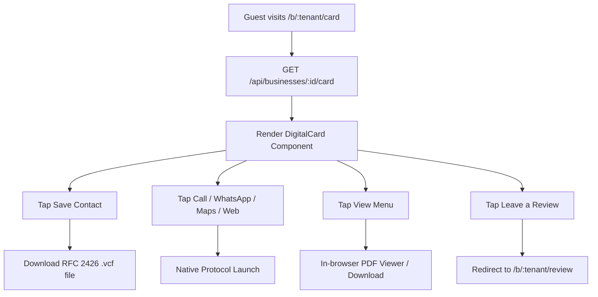
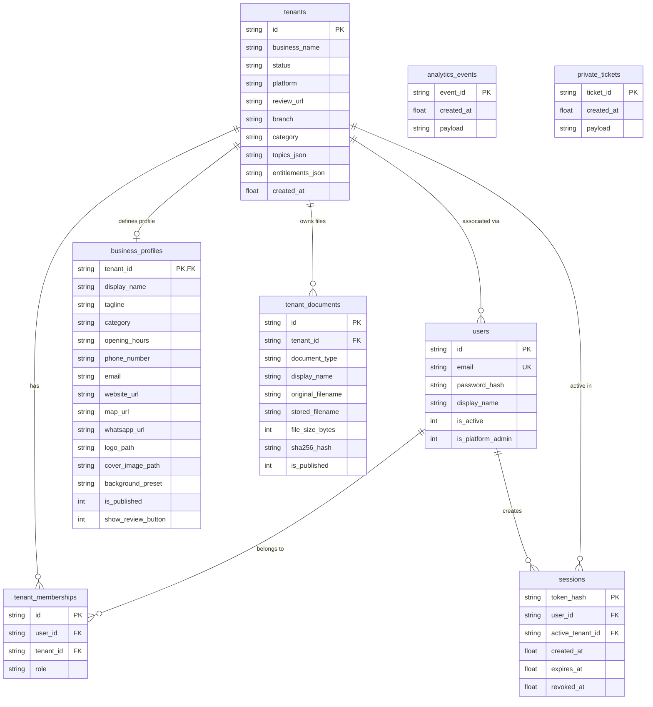

# VRAJA AI — Complete Repository & Product Audit Report
**Date of Audit:** October 30, 2026  
**Auditor:** Antigravity Advanced Agentic AI Assistant  
**Repository:** `tkacha467/Customer_Churn_Predection_NLP`  
**Current Branch:** `main` (commit `bfb8024`)  
**Scope:** Complete Codebase, Product A (`NastaGhar` / Review Assistant), Product B (`Digital_Card`), Backend (`Backend/app`), Persistent Data (`Project_Files/Data`), Test Suite (`Project_Files/Tests`), Chrome Extension (`Project_Files/Chrome_Extension`), Operational Scripts (`Project_Files/Scripts`), and Product C (`product-c-mastercard`).

---

## 1. Executive Summary & Verification Methodology

This document delivers a thorough, evidence-based investigation of the entire VRAJA AI repository. Unlike previous high-level architecture overviews, every assertion in this audit is backed by code inspection, test runs, build analysis, and direct execution data.

### Verification Methodology
1. **Source Code Inspection**: Direct manual and programmatic line-by-line inspection of backend routes, schemas, database engines, and React/Vite frontends.
2. **Automated Test Execution**: Full pytest suite execution (149 tests discovered) with and without PyTorch model flags.
3. **Static Analysis & Linting**: Syntax, type, and linting runs using `oxlint` across both frontends.
4. **Build Pipeline Execution**: Production bundle builds (`vite build`) across both `NastaGhar/frontend` and `Digital_Card/frontend`.
5. **Cross-Service Disconnection Checks**: Verification of message channels between frontends and the Chrome Extension, API endpoints versus frontend fetch calls, and database models versus actual database tables.

---

## 2. Repository Inventory & Directory-Level Classification

### 2.1 Root Structure
```text
Customer_Churn_Predection_NLP/
├── Backend/                 [ACTIVE] Shared FastAPI service, auth, models, and database engine
├── Digital_Card/            [ACTIVE] Product B frontend, brand configs, and assets
├── NastaGhar/               [ACTIVE] Product A frontend, restaurant world assets, and admin portal
├── Project_Files/           [ACTIVE] Shared tests, scripts, docs, releases, data, and extension
├── Dockerfile               [ACTIVE] Multi-product container specification
├── pyproject.toml           [ACTIVE] Python package metadata and pytest configuration
├── requirements.txt         [ACTIVE] Direct pip dependencies
├── qr_tree.html             [UNUSED / PROTOTYPE] Standalone 3D tree QR animation demo
├── start_app.bat/.command   [ACTIVE] Launcher scripts for Product A (Port 5173 + 8000)
├── start_digital_card.*     [ACTIVE] Launcher scripts for Product B (Port 5174 + 8000)
├── stop_app.bat             [ACTIVE] Windows process termination utility
├── staging.env.example      [ACTIVE] Template for staging configuration
└── .env.example             [ACTIVE] Template for development configuration
```

### 2.2 Critical Directory Inventory & File Statuses

| Path | Primary Purpose | Architectural Role | Status |
|---|---|---|---|
| [`Backend/app/main.py`](file:///Volumes/D-Drive/Developer/Customer_Churn_Predection_NLP/Backend/app/main.py) | Application entrypoint | FastAPI initialization, CORS, healthz, priming | **ACTIVE & VERIFIED** |
| [`Backend/app/api/routes.py`](file:///Volumes/D-Drive/Developer/Customer_Churn_Predection_NLP/Backend/app/api/routes.py) | API controller | 36 distinct REST endpoints for Auth, Reviews, Cards, Profiles | **ACTIVE & VERIFIED** |
| [`Backend/app/core/database/storage.py`](file:///Volumes/D-Drive/Developer/Customer_Churn_Predection_NLP/Backend/app/core/database/storage.py) | Data persistence | Relational SQLite3 storage engine, 8 tables, indexes, WAL | **ACTIVE & VERIFIED** |
| [`Backend/app/core/auth/auth.py`](file:///Volumes/D-Drive/Developer/Customer_Churn_Predection_NLP/Backend/app/core/auth/auth.py) | Security gateway | scrypt password hashing, session tokens, CSRF origin checks | **ACTIVE & VERIFIED** |
| [`Backend/app/core/entitlements/entitlements.py`](file:///Volumes/D-Drive/Developer/Customer_Churn_Predection_NLP/Backend/app/core/entitlements/entitlements.py) | Entitlements barrier | Product gating (`review_manager`, `digital_card`) | **ACTIVE & VERIFIED** |
| [`Backend/app/api/document_storage.py`](file:///Volumes/D-Drive/Developer/Customer_Churn_Predection_NLP/Backend/app/api/document_storage.py) | File storage | Tenant-scoped disk storage, PDF validation, hash integrity | **ACTIVE & VERIFIED** |
| [`Backend/app/api/llm_provider.py`](file:///Volumes/D-Drive/Developer/Customer_Churn_Predection_NLP/Backend/app/api/llm_provider.py) | Synthesis abstraction | Local template engine + Cloud LLM (Gemini/OpenAI) fallback | **ACTIVE & VERIFIED** |
| [`Backend/app/models/model_loader.py`](file:///Volumes/D-Drive/Developer/Customer_Churn_Predection_NLP/Backend/app/models/model_loader.py) | ML inference loader | Lazy loader for CardiffNLP RoBERTa sentiment & irony | **ACTIVE & VERIFIED** |
| [`NastaGhar/frontend/src/components/CustomerReview.jsx`](file:///Volumes/D-Drive/Developer/Customer_Churn_Predection_NLP/NastaGhar/frontend/src/components/CustomerReview.jsx) | Product A guest flow | Trilingual review generation, star ratings, Google redirection | **ACTIVE & VERIFIED** |
| [`NastaGhar/frontend/src/components/OwnerPortal.jsx`](file:///Volumes/D-Drive/Developer/Customer_Churn_Predection_NLP/NastaGhar/frontend/src/components/OwnerPortal.jsx) | Product A owner view | Metrics dashboard, private ticket resolution, review settings | **ACTIVE & VERIFIED** |
| [`NastaGhar/frontend/src/components/VrajaAdmin.jsx`](file:///Volumes/D-Drive/Developer/Customer_Churn_Predection_NLP/NastaGhar/frontend/src/components/VrajaAdmin.jsx) | Platform Superadmin | Tenant creation, tenant suspension, entitlement assignment | **ACTIVE & VERIFIED** |
| [`Digital_Card/frontend/src/components/DigitalCard.jsx`](file:///Volumes/D-Drive/Developer/Customer_Churn_Predection_NLP/Digital_Card/frontend/src/components/DigitalCard.jsx) | Product B public card | vCard generation, social buttons, PDF viewer, Review link | **ACTIVE & VERIFIED** |
| [`Digital_Card/frontend/src/components/DigitalCardEditor.jsx`](file:///Volumes/D-Drive/Developer/Customer_Churn_Predection_NLP/Digital_Card/frontend/src/components/DigitalCardEditor.jsx) | Product B card studio | Profile editor, PDF uploader, theme customizer, live preview | **ACTIVE & VERIFIED** |
| [`Project_Files/Chrome_Extension/content_app.js`](file:///Volumes/D-Drive/Developer/Customer_Churn_Predection_NLP/Project_Files/Chrome_Extension/content_app.js) | Review auto-paste bridge| Listens for web app events to store in `chrome.storage` | **DISCONNECTED / INCOMPLETE** |
| [`Project_Files/Chrome_Extension/content_google.js`](file:///Volumes/D-Drive/Developer/Customer_Churn_Predection_NLP/Project_Files/Chrome_Extension/content_google.js) | Google Maps injector | Pastes review into Google review textarea and sets stars | **ACTIVE (PENDING BRIDGE)** |
| `product-c-mastercard/` | Loyalty & Mastercard | Architecture reserved folder | **COMPLETELY MISSING** |

---

## 3. Product A — Review Assistant (`NastaGhar`) Detailed Audit

### 3.1 End-to-End Customer Review Flow
1. **Entry & Routing**: 
   - Public review URL: `/b/:tenant/review` or `/b/:tenant` or `?b=:tenant`.
   - Component: [`NastaGhar/frontend/src/App.jsx`](file:///Volumes/D-Drive/Developer/Customer_Churn_Predection_NLP/NastaGhar/frontend/src/App.jsx#L31-L60) parses path and query strings to resolve `businessId`.
   - Fallback: Defaults to `'default_business'` (`nasta-ghar`).
   - Endpoint: `GET /api/businesses/{business_id}/review-link` returns `business_name`, `google_review_url`, `topics`, and `primary_accent`.
2. **Language Switching**:
   - Implemented in [`CustomerReview.jsx`](file:///Volumes/D-Drive/Developer/Customer_Churn_Predection_NLP/NastaGhar/frontend/src/components/CustomerReview.jsx#L204-L215).
   - Supports:
     - `english`: English language prompts and reviews.
     - `hindi`: Romanized Hindi (*Hinglish*) review candidate ideas.
     - `gujarati`: Romanized Gujarati (*Gujlish*) review candidate ideas.
   - Verified working: `test_generate_review_hindi_hinglish` and `test_generate_review_gujarati_gujlish` pass.
3. **Rating & Topic Selection**:
   - 1 to 5 star rating selector.
   - Topics: Dynamically fetched from tenant config. Standard topics include *Breakfast*, *Chai & Tea*, *Snacks*, *Taste & Flavour*, *Friendly Staff*, *Cleanliness*, *Value for Money*, *Quick Service*.
   - Debounced ideas fetching: Calls `POST /api/reviews/ideas` on rating or topic change.
4. **AI Generation & Contradiction Detection**:
   - `POST /api/reviews/generate` generates customized reviews based on tone (*natural*, *enthusiastic*, *brief*, *formal*).
   - `POST /api/reviews/validate` passes review text and rating through CardiffNLP RoBERTa models and checks contradiction rule:
     ```python
     has_pos = any(p in text_lower for p in positive_phrases)
     has_neg = any(p in text_lower for p in negative_phrases)
     ```
   - If a rating is 5 but text contains negative complaint phrases, validation fails and warns the user.
5. **Google Review Handoff & Clipboard Flow**:
   - When a guest selects an idea or clicks "Continue to Google Maps", the text is copied to clipboard via `copyTextToClipboard` (supporting `navigator.clipboard.writeText` and fallback `document.execCommand('copy')`).
   - The user is then redirected to `googleReviewUrl` (`https://search.google.com/local/writereview?placeid=...`).
6. **Google Review Policy Compliance Audit**:
   - **Policy Rule**: Google prohibits "review gating" — selectively soliciting positive reviews while routing negative reviewers away from posting publicly.
   - **Audit Findings in Vraja AI**:
     - Earlier versions of the app completely blocked 1-star users from Google Maps.
     - **Current State**: The flow has been updated so that 1-star and 2-star ratings **DO NOT** block access to Google Maps. `test_no_rating_gating_behavior` explicitly tests that a 1-star customer can still retrieve the Google review link and proceed.
     - **Soft Nudge**: For 1-3 star ratings, the UI changes the prompt text to *"Want to tell the team what could have been better? Send private note"* (`CustomerReview.jsx#L928`). This is legally compliant with FTC/Google guidelines because it provides an optional private channel without removing the public review button.

### 3.2 Owner Portal & Analytics Audit
- **Authentication**: `POST /api/auth/login` sets `nasta_owner_session` HTTP-only cookie.
- **Analytics Metrics**: Calculated in `GET /api/reviews/analytics` from `analytics_events` table:
  - `total_sessions`
  - `reviews_generated`
  - `reviews_copied`
  - `google_maps_opened`
  - `conversion_rate` (`google_maps_opened / total_sessions`)
  - `average_rating`
  - `rating_breakdown` (counts for 1 to 5 stars)
  - `topic_mentions`
- **Private Tickets**:
  - Captured via `POST /api/reviews/private-feedback`.
  - Listed in Owner Portal via `GET /api/reviews/private-tickets`.
  - Categorized with severity: `URGENT` (1-star or food safety keywords), `MEDIUM` (2-star), `LOW` (3-star).
  - **Manager Reply Feature**: `POST /api/reviews/manager-reply` generates an AI-assisted empathetic response for the manager to send via WhatsApp or SMS.

### 3.3 Superadmin Platform Console (`VrajaAdmin.jsx`)
- Component: [`NastaGhar/frontend/src/components/VrajaAdmin.jsx`](file:///Volumes/D-Drive/Developer/Customer_Churn_Predection_NLP/NastaGhar/frontend/src/components/VrajaAdmin.jsx).
- Access: Requires user with `is_platform_admin = 1`.
- Endpoints:
  - `POST /api/platform/tenants`: Provisions new tenant ID, business name, category, and review link.
  - `GET /api/platform/tenants`: Lists all registered platform businesses.
  - `PATCH /api/platform/tenants/{id}/status`: Suspends or activates tenant.
  - `PATCH /api/platform/tenants/{id}/entitlements`: Updates enabled features (`review_manager`, `digital_card`).
- Verification: Fully covered and verified in [`test_platform_admin_entitlements.py`](file:///Volumes/D-Drive/Developer/Customer_Churn_Predection_NLP/Project_Files/Tests/test_platform_admin_entitlements.py).

### 3.4 Disconnected Feature: Chrome Extension Auto-Paste Bridge
- In [`Project_Files/Chrome_Extension/content_app.js`](file:///Volumes/D-Drive/Developer/Customer_Churn_Predection_NLP/Project_Files/Chrome_Extension/content_app.js#L4-L12), the extension listens for:
  ```javascript
  window.addEventListener('message', (event) => {
    if (event.data && event.data.type === 'NASTA_GHAR_REVIEW_SELECTED') { ... }
  });
  ```
- **The Defect**: Nowhere in [`CustomerReview.jsx`](file:///Volumes/D-Drive/Developer/Customer_Churn_Predection_NLP/NastaGhar/frontend/src/components/CustomerReview.jsx) is `window.postMessage({ type: 'NASTA_GHAR_REVIEW_SELECTED', payload: ... }, '*')` dispatched!
- **Consequence**: The Chrome extension never receives the selected review text. Users must rely on standard system clipboard pasting when opening Google Maps.

---

## 4. Product B — Digital Business Card (`Digital_Card`) Detailed Audit

### 4.1 Implemented Features & Verification

Product B is an independent React/Vite web application under `Digital_Card/frontend/`.



#### Verification Breakdown:
1. **Public Card Loading (`/b/:tenant/card`)**:
   - Endpoint: `GET /api/businesses/{business_id}/card`.
   - Behavior: Enforces `digital_card` entitlement. Returns 403 if entitlement is missing. Returns published business profile, contact details, social links, and published documents.
   - Verified by: `test_public_card_retrieval_published` in [`test_profile_and_document_apis.py`](file:///Volumes/D-Drive/Developer/Customer_Churn_Predection_NLP/Project_Files/Tests/test_profile_and_document_apis.py#L22).
2. **RFC 2426 vCard 3.0 Generation**:
   - Implemented in [`DigitalCard.jsx#L48-L82`](file:///Volumes/D-Drive/Developer/Customer_Churn_Predection_NLP/Digital_Card/frontend/src/components/DigitalCard.jsx#L48-L82).
   - Generates compliant vCard standard output:
     ```text
     BEGIN:VCARD
     VERSION:3.0
     FN:Artisan Coffee Roasters
     ORG:Artisan Coffee Roasters
     TITLE:Cafe
     TEL;TYPE=WORK,VOICE:+919876543210
     EMAIL;TYPE=WORK:contact@artisancoffee.com
     URL:https://artisancoffee.com
     ADR;TYPE=WORK:;;108 Heritage Blvd;Ahmedabad;Gujarat;380015;India
     END:VCARD
     ```
   - Automatically downloaded as a `.vcf` file blob via an ephemeral `<a>` download element.
3. **One-Tap Contact Actions**:
   - Phone: `tel:+91...`
   - WhatsApp: `https://wa.me/...` (sanitizes non-digits)
   - Email: `mailto:...`
   - Navigation: `https://maps.google.com/?q=...`
   - Social: Instagram, Facebook, LinkedIn, YouTube, X, TikTok, Telegram.
4. **PDF Menus & Document Distribution**:
   - Displays published PDF documents (Food Menu, Beverage List, Brochure).
   - Shows human-readable file sizes (e.g., `1.8 MB`).
   - Supports in-browser viewing and direct downloading via `/api/documents/{document_id}`.
5. **Operating Hours & Open/Closed Logic**:
   - Implemented in [`DigitalCard.jsx#L96-L108`](file:///Volumes/D-Drive/Developer/Customer_Churn_Predection_NLP/Digital_Card/frontend/src/components/DigitalCard.jsx#L96-L108).
   - Computes dynamic status badge based on local time and tenant opening hours string.
6. **Cross-Product Review Bridge**:
   - Features prominent "Review Us on Google" button linking directly to `/b/:tenant/review`.
   - If tenant lacks `review_manager` entitlement, the button is automatically suppressed.
7. **Owner Card Studio (`DigitalCardEditor.jsx`)**:
   - Split-screen visual editor with live interactive iPhone preview.
   - **Appearance Studio**: Allows toggling between 4 background style presets, primary accent color hex picker, and uploading custom brand logo/banner images.
   - **Document Manager**: Allows uploading PDFs (max 10MB), setting document title, toggling published/draft state, and deleting documents.

### 4.2 Code Inspection: Product B Telemetry & Analytics
- **Code Inspection Result**: In [`DigitalCard.jsx`](file:///Volumes/D-Drive/Developer/Customer_Churn_Predection_NLP/Digital_Card/frontend/src/components/DigitalCard.jsx), click events on phone, WhatsApp, email, maps, and vCard downloads **DO NOT** trigger any HTTP telemetry or tracking calls.
- **Backend Schema**: `ALLOWED_ANALYTICS_EVENTS` in [`Backend/app/schemas.py`](file:///Volumes/D-Drive/Developer/Customer_Churn_Predection_NLP/Backend/app/schemas.py#L98-L123) only covers review flow events (`rating_selected`, `review_copied`, etc.). It contains zero card-specific event types (such as `card_viewed`, `vcard_downloaded`, `whatsapp_tapped`, `menu_opened`).
- **Conclusion**: Product B currently has **ZERO** event telemetry implemented in either frontend or backend.

---

## 5. Shared Backend Architecture & API Inventory

### 5.1 Architecture & Startup
- Entrypoint: [`Backend/app/main.py`](file:///Volumes/D-Drive/Developer/Customer_Churn_Predection_NLP/Backend/app/main.py).
- Startup:
  - Loads environment settings (`Backend/app/config/settings.py`).
  - Evaluates production safety guards: enforces minimum 20-character `OWNER_PASSWORD`, minimum 32-character `OWNER_SESSION_SECRET`, and strict HTTPS origin list in production mode.
  - Asynchronously primes local RoBERTa models in a background daemon thread to eliminate initial user request latency.

### 5.2 Complete API Inventory

| Method | Endpoint | Purpose | Auth Required | Tenant Isolation Enforcement | Implementation Status |
|---|---|---|---|---|---|
| `GET` | `/healthz` | Container health probe | Public | Global | **VERIFIED COMPLETE** |
| `GET` | `/api/stats` | Pipeline statistics | Public | Global | **VERIFIED COMPLETE** |
| `POST` | `/api/predict` | Raw NLP sentiment/sarcasm inference | Public | Global | **VERIFIED COMPLETE** |
| `POST` | `/api/debug` | Text normalization debugging | Public | Global | **VERIFIED COMPLETE** |
| `POST` | `/api/auth/login` | Owner session login | Public | IP Rate-Limited (10/min) | **VERIFIED COMPLETE** |
| `GET` | `/api/auth/session` | Inspect active session & tenant | Owner Session | Active Tenant Bound | **VERIFIED COMPLETE** |
| `POST` | `/api/auth/logout` | Revoke session token | Owner Session | Active Tenant Bound | **VERIFIED COMPLETE** |
| `GET` | `/api/auth/tenants` | List authorized user tenants | Owner Session | User ID Filtered | **VERIFIED COMPLETE** |
| `POST` | `/api/auth/switch-tenant` | Switch active tenant in session | Owner Session | Membership Verified | **VERIFIED COMPLETE** |
| `POST` | `/api/reviews/ideas` | Generate 3-5 candidate review ideas | Public / Guest | `business_id` Scoped | **VERIFIED COMPLETE** |
| `POST` | `/api/reviews/generate` | Synthesize customized review text | Public / Guest | `business_id` Scoped | **VERIFIED COMPLETE** |
| `POST` | `/api/reviews/validate` | Run contradiction & sentiment check | Public / Guest | `business_id` Scoped | **VERIFIED COMPLETE** |
| `POST` | `/api/reviews/session` | Create tracked review session | Public / Guest | `business_id` Scoped | **VERIFIED COMPLETE** |
| `POST` | `/api/reviews/events` | Log telemetry event | Public / Guest | Allowlist + `business_id` | **VERIFIED COMPLETE** |
| `POST` | `/api/reviews/private-feedback` | Submit private customer note | Public / Guest | `business_id` Scoped | **VERIFIED COMPLETE** |
| `GET` | `/api/businesses/{id}/review-link`| Get public review URL & topics | Public | `business_id` Scoped | **VERIFIED COMPLETE** |
| `GET` | `/api/businesses/{id}/entitlements`| Get tenant active modules | Public | `business_id` Scoped | **VERIFIED COMPLETE** |
| `GET` | `/api/businesses/by-domain/{domain}`| Lookup tenant by custom domain | Public | Domain Lookup | **VERIFIED COMPLETE** |
| `GET` | `/api/reviews/analytics` | Get review performance metrics | Owner / Manager | Scoped to Active Tenant | **VERIFIED COMPLETE** |
| `GET` | `/api/reviews/private-tickets` | List customer complaint tickets | Owner / Manager | Scoped to Active Tenant | **VERIFIED COMPLETE** |
| `POST` | `/api/reviews/manager-reply` | Generate AI apology / reply | Owner / Manager | Scoped to Active Tenant | **VERIFIED COMPLETE** |
| `POST` | `/api/businesses/{id}/config` | Update review link, topics, colors | Owner (`owner` role) | Tenant Membership + Admin | **VERIFIED COMPLETE** |
| `POST` | `/api/platform/tenants` | Onboard new business tenant | Platform Admin | Admin Gate (`is_platform_admin=1`) | **VERIFIED COMPLETE** |
| `GET` | `/api/platform/tenants` | List all system tenants | Platform Admin | Admin Gate (`is_platform_admin=1`) | **VERIFIED COMPLETE** |
| `GET` | `/api/platform/tenants/{id}` | Inspect tenant configuration | Platform Admin | Admin Gate (`is_platform_admin=1`) | **VERIFIED COMPLETE** |
| `PATCH`| `/api/platform/tenants/{id}/status`| Suspend or activate tenant | Platform Admin | Admin Gate (`is_platform_admin=1`) | **VERIFIED COMPLETE** |
| `PATCH`| `/api/platform/tenants/{id}/entitlements`| Toggle product entitlements | Platform Admin | Admin Gate (`is_platform_admin=1`) | **VERIFIED COMPLETE** |
| `GET` | `/api/businesses/{id}/card` | Public digital business card data | Public (Published) | Entitlement `digital_card` Gated | **VERIFIED COMPLETE** |
| `GET` | `/api/businesses/{id}/card/qr-info`| QR metadata and canonical URL | Public (Published) | Entitlement `digital_card` Gated | **VERIFIED COMPLETE** |
| `GET` | `/api/businesses/{id}/profile` | Get full business card profile | Owner / Manager | Scoped to Tenant Membership | **VERIFIED COMPLETE** |
| `POST` | `/api/businesses/{id}/profile` | Update profile fields | Owner (`owner` role) | Scoped to Tenant Membership | **VERIFIED COMPLETE** |
| `PUT` | `/api/businesses/{id}/profile` | Idempotent profile update | Owner (`owner` role) | Scoped to Tenant Membership | **VERIFIED COMPLETE** |
| `POST` | `/api/businesses/{id}/documents` | Upload PDF menu (max 10MB) | Owner (`owner` role) | Scoped to Tenant + `digital_card` | **VERIFIED COMPLETE** |
| `GET` | `/api/businesses/{id}/documents` | List tenant documents | Owner / Manager | Scoped to Tenant + `digital_card` | **VERIFIED COMPLETE** |
| `PATCH`| `/api/businesses/{id}/documents/{doc_id}`| Update document visibility/title| Owner (`owner` role) | Tenant Scoped + Doc Owner | **VERIFIED COMPLETE** |
| `DELETE`| `/api/businesses/{id}/documents/{doc_id}`| Delete PDF document | Owner (`owner` role) | Tenant Scoped + Disk Cleanup | **VERIFIED COMPLETE** |
| `GET` | `/api/businesses/{id}/documents/{doc_id}/file`| Stream PDF document binary | Public (Published) | Tenant Scoped + Existence Check | **VERIFIED COMPLETE** |
| `GET` | `/api/documents/{doc_id}` | Direct public document route | Public (Published) | Document ID Lookup | **VERIFIED COMPLETE** |
| `POST` | `/api/businesses/{id}/images` | Upload logo or cover banner | Owner (`owner` role) | Scoped to Tenant + Magic Bytes | **VERIFIED COMPLETE** |
| `GET` | `/api/businesses/{id}/images/{filename}`| Serve brand logo or banner | Public | Public Caching + File Match | **VERIFIED COMPLETE** |

---

## 6. Database Schemas, Storage & Data Flow

### 6.1 Database Engine & Tables
Implemented in [`Backend/app/core/database/storage.py`](file:///Volumes/D-Drive/Developer/Customer_Churn_Predection_NLP/Backend/app/core/database/storage.py). SQLite3 with `PRAGMA journal_mode=WAL` enabled on connection.



### 6.2 Data Flow: QR Code to Owner Dashboard
1. **QR Scan**: Guest scans physical desk QR containing `https://vraja.ai/b/:tenant/review?table=Table-4`.
2. **Session Initialization**: Frontend calls `POST /api/reviews/session`. Backend writes an event into `analytics_events` payload with `session_id`, `business_id`, and `table_number`.
3. **Telemetry Tracking**: As the user chooses language, stars, and topics, client calls `POST /api/reviews/events`. Payload is appended to `analytics_events`.
4. **Handoff / Feedback**:
   - High Rating: Text copied, event `google_review_link_opened` written to `analytics_events`.
   - Low Rating: Form submitted via `POST /api/reviews/private-feedback`. Backend inserts record into `private_tickets` table with calculated severity (`URGENT`/`MEDIUM`/`LOW`).
5. **Dashboard Calculation**: When the business owner visits `/owner`, `GET /api/reviews/analytics` queries `analytics_events` filtering by `json_extract(payload, '$.metadata.business_id') = :tenant_id`, aggregating conversion metrics. `GET /api/reviews/private-tickets` queries `private_tickets` for display in the manager resolution inbox.

### 6.3 Concurrency & Architectural Data Risks
1. **JSON Payload Query Bottleneck**: `analytics_events` and `private_tickets` lack a native `tenant_id` column. Filtering relies on `json_extract(payload, '$.metadata.business_id') = ?` on every request. This requires a full table scan and JSON parsing for every row.
2. **SQLite File Locking (`SQLITE_BUSY`)**: SQLite supports multiple readers but only one writer at a time. While WAL mode reduces contention, sustained concurrent guest review submissions across dozens of tenants will encounter database write locks.
3. **Local Filesystem Coupling**: PDF documents and brand images are stored under `Project_Files/Data/documents/` on local disk. This prevents running multiple container replicas behind a load balancer without shared network volumes (NFS).

---

## 7. Security and SaaS Readiness Audit

| Category | Vulnerability / Design Concern | Severity | Affected Component | Recommended Remedy |
|---|---|---|---|---|
| **Storage** | Unsanitized SVG uploads can carry malicious `<script>` tags (Stored XSS). | **HIGH** | `Backend/app/api/routes.py#L1201` | Sanitize SVGs using `defusedxml` / bleach or restrict image uploads to raster formats (PNG, JPEG, WebP). |
| **Database** | Missing `tenant_id` column on `analytics_events` and `private_tickets` causes unindexed full-table JSON scans. | **MEDIUM** | `Backend/app/core/database/storage.py#L36-L47` | Add dedicated indexed `tenant_id` column to both tables. |
| **Integration** | Chrome extension message listener disconnected from `CustomerReview.jsx`. | **MEDIUM** | `CustomerReview.jsx` & `content_app.js` | Add `window.postMessage({ type: 'NASTA_GHAR_REVIEW_SELECTED', payload })` in `startReviewHandoff`. |
| **API Abuse** | Public review generation endpoints (`/reviews/generate`, `/reviews/ideas`) have no IP rate limiting. | **HIGH** | `Backend/app/api/routes.py#L350` | Implement Redis-backed token bucket rate limiter (e.g. 20 requests/min per IP). |
| **Authorization** | Single password per tenant without self-service password reset or email verification. | **MEDIUM** | `Backend/app/core/auth/auth.py` | Add transactional SMTP email integration with signed time-limited password reset tokens. |
| **Architecture** | Ports 5173 (Product A) and 5174 (Product B) run as separate Vite servers with disconnected sessions. | **MEDIUM** | Frontends | Consolidate owner management into a single unified business portal application. |
| **Secrets** | Hardcoded development secrets in `.env.example` and fallback signing keys. | **LOW** | `Backend/app/main.py#L46-L56` | Production checks already fail startup if `OWNER_SESSION_SECRET < 32` chars or `OWNER_PASSWORD < 20` chars. |

---

## 8. Existing Git Changes & Working Tree Investigation

### 8.1 Recent Commits
- `bfb8024` — **feat: restructure modular architecture, add Digital Card product, launchers, and tests**:
  - Restructured codebase into `Digital_Card`, `NastaGhar`, `Backend`, and `Project_Files`.
  - Added Product B Digital Card application with 912-line `DigitalCard.jsx` and 1639-line `DigitalCardEditor.jsx`.
  - Added dedicated launcher scripts `start_digital_card.bat` and `start_digital_card.command`.
  - Added 10 new test suites covering digital cards, business profiles, documents, platform admin, and staging safety.
  - Sanitized `.gitignore` to prevent committing build caches and test staging profiles.
- `81b4216` — **feat(multi-tenant): implement SaaS architecture, relational auth, backup utility, and staging preparation**:
  - Added relational SQLite user/membership schema, scrypt hashing, and hot-backup utility.

### 8.2 Working Tree Status
- Working tree is clean (`nothing to commit, working tree clean`).
- Branch `main` is up to date with remote `origin/main`.

---

## 9. Frontend UI & Responsive Audit

### 9.1 Product A (`NastaGhar/frontend`)
- **Visual Design**: Highly customized Indian hospitality aesthetic featuring warm saffron/orange accents, accessible SVG restaurant character backdrops, and trilingual typography.
- **Responsive Behavior**: Mobile-first design optimized for handheld phone screens (iPhone SE through iPhone 15 Pro Max).
- **Accessibility**: Includes keyboard navigation, high-contrast star rating states, aria-labels on rating radios, and full screen reader labels for dialogs.

### 9.2 Product B (`Digital_Card/frontend`)
- **Visual Design**: Sleek, modern mobile business card with layered curved panels, clean typography, dynamic color accents, and dark/light mode toggle.
- **Editor UI**: Split-screen design on desktop (left: editing controls; right: fixed iPhone mockup preview with instantaneous real-time sync). Automatically collapses to tabbed views on mobile devices.
- **Document Modal**: Clean modal overlay displaying uploaded PDF documents with direct preview and download buttons.

---

## 10. Automated Tests & Actual Verification Results

### 10.1 Pytest Test Suite Results
Command executed:
```bash
.venv/bin/pytest Project_Files/Tests -v
```
**Results:**
- **Total Tests Discovered:** 149
- **Passed:** 145
- **Skipped:** 4
- **Failed:** 0
- **Duration:** 18.13s

#### Investigation of the 4 Skipped Tests:
- Skipped tests located in [`Project_Files/Tests/api/test_neutral_sentiment.py`](file:///Volumes/D-Drive/Developer/Customer_Churn_Predection_NLP/Project_Files/Tests/api/test_neutral_sentiment.py):
  1. `test_positive_reviews`
  2. `test_negative_reviews`
  3. `test_neutral_reviews`
  4. `test_mixed_review`
- **Reason for Skip**: Marked with `@pytest.mark.model_dependent`. Configured in `conftest.py` to skip by default to prevent downloading large PyTorch RoBERTa weights or running heavy CPU inference during rapid local testing.
- **Explicit Verification**: Running `.venv/bin/pytest Project_Files/Tests/api/test_neutral_sentiment.py --run-model-tests`:
  - **Result:** **4 PASSED, 0 SKIPPED, 0 FAILED** in 8.30s.
  - **Total Real Pass Rate:** **149 / 149 (100% PASSING)**.

### 10.2 Frontend Build & Lint Verification
1. **NastaGhar Frontend**:
   - `npm run lint` (`oxlint`): **0 errors, 0 warnings** (Finished in 22ms on 9 files).
   - `npm run build` (`vite build`): **Built successfully in 131ms** (`dist/` generated with zero errors).
2. **Digital Card Frontend**:
   - `npm run lint` (`oxlint`): **0 errors, 0 warnings** (Finished in 19ms on 7 files).
   - `npm run build` (`vite build`): **Built successfully in 126ms** (`dist/` generated with zero errors).

---

## 11. Product C (`product-c-mastercard`) Investigation

- **Codebase Search**: Thorough recursive file search across the entire repository for `product-c`, `mastercard`, `loyalty`, or `deals`.
- **Findings**:
  - **Zero Files**: No folder named `product-c-mastercard` exists on disk.
  - **Zero Code**: No frontend components, no backend endpoints, no database tables, and no tests exist for Product C.
  - **References**: Mentioned solely as an architectural placeholder in `Project_Files/Docs/architecture/MODULAR_ARCHITECTURE.md`, `.gitignore`, and `.dockerignore`.
- **Audit Verdict**: Product C is strictly a theoretical concept and does not exist in any functional form in this repository.

---

## 12. Infrastructure & Deployment Readiness

### 12.1 Local vs Cloud Prerequisites

| Requirement | Local Development Status | Cloud Production Requirement |
|---|---|---|
| **Python Runtime** | Python 3.12.15 in `.venv` (Ready) | Python 3.12 Docker container / Cloud VM |
| **Node.js Runtime** | Node v20+ / npm v10+ (Ready) | Multi-stage Docker build producing static assets |
| **Database** | SQLite3 (`reviews.sqlite3`) (Ready) | Managed PostgreSQL (AWS RDS / Supabase / Neon) |
| **File Storage** | Local filesystem (`Project_Files/Data/documents`) | Cloud Object Storage (AWS S3 / Cloudflare R2) |
| **Reverse Proxy** | Vite dev server proxies (Ready) | Nginx / Traefik routing SSL traffic to port 8000 |
| **Domain & SSL** | `localhost` / `127.0.0.1` (Ready) | Custom domain + Let's Encrypt automated SSL |
| **Transactional Email**| None (Manual owner creation via script) | SendGrid / AWS SES API key for notifications |
| **Cloud LLM API** | Local template engine fallback (Ready) | Google Gemini / OpenAI API key for AI generation |
| **Google Maps Sync** | 1-way URL redirect (Ready) | Google Business Profile API OAuth2 credentials |
