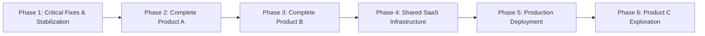

# VRAJA AI — Practical Next Steps & Priority Implementation Plan
**Audit Date:** October 30, 2026  
**Target Milestone:** Commercial Pilot & Multi-Tenant Production Readiness

---

## Roadmap Overview

---

## Phase 1: Critical Fixes & Stabilization (Immediate Local Tasks)

### Task 1.1: Reconnect the Chrome Extension Auto-Paste Bridge
- **Priority:** High
- **Reason:** The Chrome extension cannot auto-paste selected reviews into Google Maps because `CustomerReview.jsx` never posts the `NASTA_GHAR_REVIEW_SELECTED` message.
- **Dependencies:** None.
- **Relevant Files:**
  - [`NastaGhar/frontend/src/components/CustomerReview.jsx`](file:///Volumes/D-Drive/Developer/Customer_Churn_Predection_NLP/NastaGhar/frontend/src/components/CustomerReview.jsx)
  - [`Project_Files/Chrome_Extension/content_app.js`](file:///Volumes/D-Drive/Developer/Customer_Churn_Predection_NLP/Project_Files/Chrome_Extension/content_app.js)
- **Complexity:** Low
- **Environment:** Local only (no external server required).
- **Acceptance Criteria:**
  - `CustomerReview.jsx` emits `window.postMessage` with payload `{ reviewText, rating, businessId, timestamp }`.
  - Extension `content_app.js` captures event and successfully saves to `chrome.storage.local`.

### Task 1.2: Sanitize SVG Image Uploads (Prevent Stored XSS)
- **Priority:** High
- **Reason:** Uploading SVG images currently allows raw XML without stripping embedded `<script>` or event handlers.
- **Dependencies:** `python-multipart`, `defusedxml` or XML parser.
- **Relevant Files:**
  - [`Backend/app/api/routes.py#L1187-L1203`](file:///Volumes/D-Drive/Developer/Customer_Churn_Predection_NLP/Backend/app/api/routes.py#L1187-L1203)
- **Complexity:** Low
- **Environment:** Local only.
- **Acceptance Criteria:**
  - SVG uploads containing `<script>` or `onload=` are rejected with 422 Unprocessable Entity.
  - Normal raster images (PNG, JPEG, WebP) remain unaffected.

### Task 1.3: Add Dedicated `tenant_id` Column to Events & Tickets Tables
- **Priority:** High
- **Reason:** Current queries perform full-table scans with `json_extract(payload, '$.metadata.business_id') = ?`. This causes database bottlenecks as rows scale.
- **Dependencies:** None.
- **Relevant Files:**
  - [`Backend/app/core/database/storage.py`](file:///Volumes/D-Drive/Developer/Customer_Churn_Predection_NLP/Backend/app/core/database/storage.py)
- **Complexity:** Medium
- **Environment:** Local only.
- **Acceptance Criteria:**
  - `analytics_events` and `private_tickets` have indexed `tenant_id` column.
  - Idempotent migration automatically populates `tenant_id` for existing records.

---

## Phase 2: Complete Product A (Review Assistant)

### Task 2.1: Public Review Endpoint Rate Limiting
- **Priority:** High
- **Reason:** Protects local and cloud LLMs from API token exhaustion and denial-of-service.
- **Dependencies:** `slowapi` or custom sliding-window limiter.
- **Relevant Files:**
  - [`Backend/app/api/routes.py`](file:///Volumes/D-Drive/Developer/Customer_Churn_Predection_NLP/Backend/app/api/routes.py)
- **Complexity:** Medium
- **Environment:** Local only.
- **Acceptance Criteria:**
  - Guests are limited to 15 review generations per hour per IP.
  - Returns `429 Too Many Requests` with retry headers when exceeded.

### Task 2.2: Automated Manager Email / SMS Alerts on Urgent Tickets
- **Priority:** Medium
- **Reason:** Negative reviews (1-3 stars) need immediate staff resolution before the customer leaves the venue.
- **Dependencies:** SendGrid / AWS SES API or Twilio credentials.
- **Relevant Files:**
  - [`Backend/app/api/service.py`](file:///Volumes/D-Drive/Developer/Customer_Churn_Predection_NLP/Backend/app/api/service.py)
- **Complexity:** Medium
- **Environment:** Requires external transactional email / SMS API key.
- **Acceptance Criteria:**
  - When an `URGENT` ticket is created via `POST /api/reviews/private-feedback`, an alert is dispatched to the tenant owner email.

### Task 2.3: Google Business Profile API Bidirectional Sync
- **Priority:** Low
- **Reason:** Verify whether guests who clicked the link actually published the review on Google Maps.
- **Dependencies:** Verified Google Cloud Project with Google My Business API access approval.
- **Relevant Files:**
  - `Backend/app/core/tenants/google_reviews.py`
- **Complexity:** High
- **Environment:** Requires Google Cloud OAuth2 client credentials and verified domain.
- **Acceptance Criteria:**
  - System polls or receives webhooks from GMB to match published reviews with generated sessions.

---

## Phase 3: Complete Product B (Digital Business Card)

### Task 3.1: Implement Card Telemetry & Analytics Pipeline
- **Priority:** High
- **Reason:** Card owners have zero visibility into how many visitors scan the card or tap contact actions.
- **Dependencies:** Task 1.3 (`tenant_id` column).
- **Relevant Files:**
  - [`Digital_Card/frontend/src/components/DigitalCard.jsx`](file:///Volumes/D-Drive/Developer/Customer_Churn_Predection_NLP/Digital_Card/frontend/src/components/DigitalCard.jsx)
  - [`Backend/app/schemas.py`](file:///Volumes/D-Drive/Developer/Customer_Churn_Predection_NLP/Backend/app/schemas.py)
  - [`Backend/app/api/routes.py`](file:///Volumes/D-Drive/Developer/Customer_Churn_Predection_NLP/Backend/app/api/routes.py)
- **Complexity:** Medium
- **Environment:** Local only.
- **Acceptance Criteria:**
  - Tapping vCard save, WhatsApp, phone, email, and PDF menu triggers `POST /api/reviews/events` with corresponding event names (`vcard_downloaded`, `whatsapp_clicked`, `menu_viewed`).
  - Owner studio displays total card views and contact tap counts.

### Task 3.2: Interactive Native Digital Menu Builder
- **Priority:** Medium
- **Reason:** Currently menus can only be uploaded as static PDFs. Diners prefer mobile-native browsable item lists.
- **Dependencies:** None.
- **Relevant Files:**
  - `Digital_Card/frontend/src/components/DigitalCard.jsx`
  - `Digital_Card/frontend/src/components/DigitalCardEditor.jsx`
  - `Backend/app/core/database/storage.py`
- **Complexity:** High
- **Environment:** Local only.
- **Acceptance Criteria:**
  - Owners can add food items with name, price, description, and dietary tags (Veg / Non-Veg / Vegan / Spicy).
  - Public card displays searchable, categorized interactive menu alongside PDF download option.

### Task 3.3: Multi-Staff Member Profiles
- **Priority:** Low
- **Reason:** Corporate and multi-staff clients require individual business cards under a single company account.
- **Dependencies:** Database schema update.
- **Relevant Files:**
  - `Backend/app/core/database/storage.py`
  - `Digital_Card/frontend/src/App.jsx`
- **Complexity:** High
- **Environment:** Local only.
- **Acceptance Criteria:**
  - URL format `/b/:tenant/card/:staff_slug` loads individual staff card with employee title and direct contact while inheriting company branding.

---

## Phase 4: Shared SaaS Infrastructure

### Task 4.1: Unified Owner Business Portal (Consolidate Ports 5173 & 5174)
- **Priority:** High
- **Reason:** Running separate Vite dev servers and separate owner portals is confusing for business owners who subscribe to both products.
- **Dependencies:** None.
- **Relevant Files:**
  - [`NastaGhar/frontend/src/components/OwnerPortal.jsx`](file:///Volumes/D-Drive/Developer/Customer_Churn_Predection_NLP/NastaGhar/frontend/src/components/OwnerPortal.jsx)
  - [`Digital_Card/frontend/src/components/DigitalCardEditor.jsx`](file:///Volumes/D-Drive/Developer/Customer_Churn_Predection_NLP/Digital_Card/frontend/src/components/DigitalCardEditor.jsx)
- **Complexity:** High
- **Environment:** Local only.
- **Acceptance Criteria:**
  - Single business portal where an owner logs in once and has tabs for "Review Engine", "Digital Card Studio", and "Analytics".

### Task 4.2: Self-Service Password Reset Flow
- **Priority:** Medium
- **Reason:** Currently passwords can only be created via CLI script (`create_tenant_owner.py`).
- **Dependencies:** Transactional email service (Task 2.2).
- **Relevant Files:**
  - `Backend/app/core/auth/auth.py`
  - `Backend/app/api/routes.py`
- **Complexity:** Medium
- **Environment:** Requires SMTP or SendGrid API key.
- **Acceptance Criteria:**
  - "Forgot Password" link on login screen generates signed 15-minute token sent via email to reset password.

---

## Phase 5: Production Deployment

### Task 5.1: Cloud Object Storage Adapter (AWS S3 / Cloudflare R2)
- **Priority:** High
- **Reason:** Files stored on local disk will be destroyed on container restarts in cloud container platforms (AWS ECS, Google Cloud Run).
- **Dependencies:** `boto3` or `aioboto3` library; S3/R2 bucket credentials.
- **Relevant Files:**
  - [`Backend/app/api/document_storage.py`](file:///Volumes/D-Drive/Developer/Customer_Churn_Predection_NLP/Backend/app/api/document_storage.py)
- **Complexity:** Medium
- **Environment:** Requires cloud object storage bucket.
- **Acceptance Criteria:**
  - `document_storage.py` checks `STORAGE_BACKEND=s3` and seamlessly uploads/streams PDFs and images to/from S3/R2.

### Task 5.2: PostgreSQL Database Migration
- **Priority:** High
- **Reason:** SQLite cannot handle high-concurrency multi-tenant write volume and prevents multi-replica autoscaling.
- **Dependencies:** PostgreSQL server (AWS RDS, Supabase, or Neon).
- **Relevant Files:**
  - `Backend/app/core/database/storage.py`
- **Complexity:** High
- **Environment:** Requires cloud PostgreSQL instance.
- **Acceptance Criteria:**
  - Storage engine supports `DATABASE_URL=postgresql://...` using `asyncpg` or `psycopg2`.

### Task 5.3: Production Reverse Proxy & SSL Setup
- **Priority:** High
- **Reason:** Cloud deployment requires a reverse proxy to terminate SSL, enforce HTTPS, and route traffic to the unified backend.
- **Dependencies:** Domain name and Linux VM (or cloud load balancer).
- **Relevant Files:**
  - [`Dockerfile`](file:///Volumes/D-Drive/Developer/Customer_Churn_Predection_NLP/Dockerfile)
  - `docker-compose.prod.yml`
- **Complexity:** Medium
- **Environment:** Requires production server and domain name.
- **Acceptance Criteria:**
  - Nginx terminates SSL via Let's Encrypt and routes API calls to FastAPI on port 8000 and static frontends.

---

## Phase 6: Product C (Mastercard / Loyalty & Payments)

### Task 6.1: Loyalty Architecture & Scoping
- **Priority:** Low
- **Reason:** Product C is currently a concept placeholder with zero code.
- **Dependencies:** Successful rollout and revenue generation from Products A and B.
- **Complexity:** High
- **Environment:** Requires financial merchant accounts or Mastercard Open Banking API access.
- **Acceptance Criteria:**
  - Define formal PRD and data models for customer loyalty stamping, points, and merchant deals before writing code.
