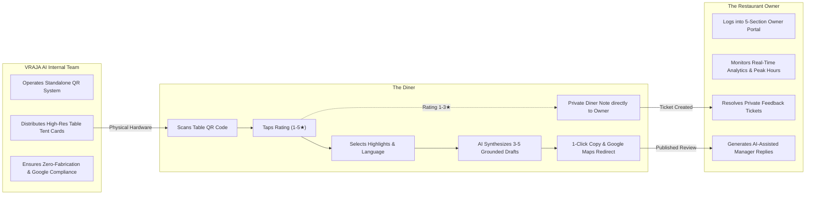
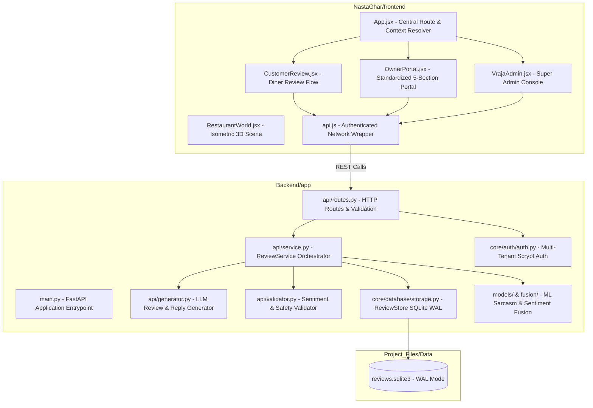
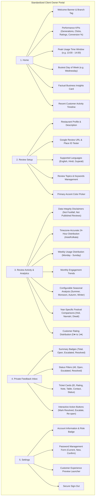
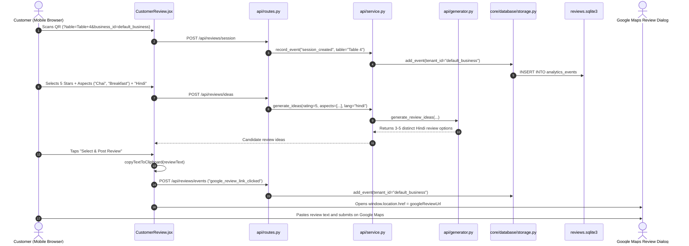
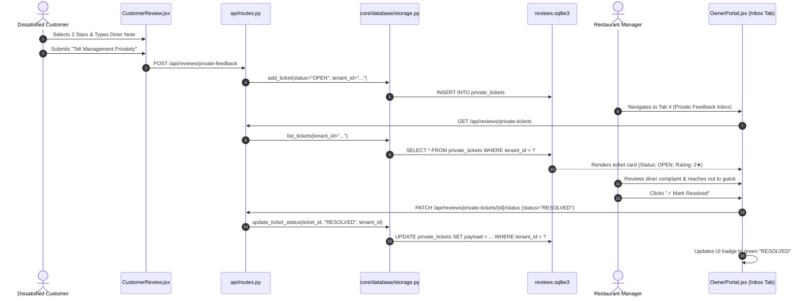

# VRAJA AI — PRODUCT A: THE COMPLETE PRODUCT STORY & ARCHITECTURE REPORT
## A Comprehensive Team Guide to the AI Review Assistant, Diner Feedback System & Architecture

> **Document Classification:** Internal Technical & Product Onboarding Report  
> **Target Audience:** All current and onboarding Frontend Engineers, Backend Engineers, Machine Learning Developers, and Product Team Members  
> **Repository:** `tkacha467/Customer_Churn_Predection_NLP`  
> **Primary Components:** `NastaGhar/frontend/` & `Backend/app/`  
> **Date:** November 2026  

---

## 1. The Product Story: Why Product A Exists

### 1.1 The Dining Experience Dilemma
Imagine sitting at a buzzing breakfast cafe in Rajkot. You just enjoyed a steaming cup of freshly brewed ginger chai and crisp, warm fafda. The hospitality was warm, the tables were clean, and the food was delicious.

As you finish, the cafe owner hopes you will leave a 5-star Google review. But what actually happens?
- You pull out your phone, open Google Maps, see a blank text box, and hesitate. *What should I write? How do I describe it?*
- Writing on a mobile screen while dining with friends or family feels tedious.
- 9 times out of 10, diners either abandon the review entirely or leave a bare 5-star rating without text.

In Google’s search and local ranking algorithm, **reviews without descriptive text carry significantly less weight than keyword-rich, authentic, humanized reviews** that mention specific items like *"Special Chai"*, *"Clean Ambiance"*, or *"Fast Service"*.

Now imagine the opposite scenario: a diner’s tea was served lukewarm, or their order took 25 minutes. If they have no direct, private way to voice their frustration, they vent where it hurts most: a public, permanent 1-star Google review.

### 1.2 How VRAJA AI Solves This
**Product A** (internally branded as **NastaGhar** / **Vraja Review Studio**) is a multi-tenant B2B SaaS application designed to solve both problems simultaneously through three interconnected personas:



### 1.3 The Three Core Ethical Invariants
1. **Google Anti-Gating Policy Compliance**: Many rogue review software vendors practice "review gating" (intercepting negative reviews and preventing users from opening Google Reviews). Google’s policy strictly forbids this. In VRAJA AI, diners selecting 1, 2, or 3 stars are offered a private management feedback channel, but the button to proceed to Google Reviews is **never blocked or hidden**.
2. **Zero-Fabrication Synthesis**: Our AI engine never hallucinates fake dishes or discounts. If a diner selects *"Breakfast"* and *"Cleanliness"*, the generated review draft focuses strictly on those aspects in 15–45 concise, warm words.
3. **Data Integrity Standard**: Review-system usage reflects digital review assistant engagement and is **never represented as actual restaurant dining footfall**. Similarly, Google link clicks are logged as customer journeys directed to Maps, not false confirmed reviews.

---

## 2. Product A Architecture: High-Level Overview

Product A is composed of a **FastAPI asynchronous Python backend** and a **React 19 / Vite 8 frontend**:



---

## 3. Directory Map & File Configuration Reference

### 3.1 Key Configuration Files & Paths

| Configuration File Path | Role & Operational Responsibility | Key Settings & Defaults |
| :--- | :--- | :--- |
| [`Backend/app/config/settings.py`](file:///Volumes/D-Drive/Developer/Customer_Churn_Predection_NLP/Backend/app/config/settings.py) | Central backend application settings | Secret keys, CORS origins, environment mode (`development`, `staging`, `production`) |
| [`Backend/app/core/tenants/business_links.json`](file:///Volumes/D-Drive/Developer/Customer_Churn_Predection_NLP/Backend/app/core/tenants/business_links.json) | Authoritative tenant seed configuration | Default business mappings, initial topics, Google review URLs |
| [`Project_Files/Data/nasta-ghar/reviews.sqlite3`](file:///Volumes/D-Drive/Developer/Customer_Churn_Predection_NLP/Project_Files/Data/nasta-ghar/reviews.sqlite3) | Primary SQLite relational database | WAL journal mode, indexed tenant data, schema definition |
| [`NastaGhar/frontend/vite.config.js`](file:///Volumes/D-Drive/Developer/Customer_Churn_Predection_NLP/NastaGhar/frontend/vite.config.js) | Frontend Vite build configuration | Port 5173, React plugin, build chunking optimizations |
| [`NastaGhar/frontend/package.json`](file:///Volumes/D-Drive/Developer/Customer_Churn_Predection_NLP/NastaGhar/frontend/package.json) | Frontend dependencies & scripts | React 19, Lucide icons, Vite 8 scripts (`dev`, `build`) |
| [`pyproject.toml`](file:///Volumes/D-Drive/Developer/Customer_Churn_Predection_NLP/pyproject.toml) & [`requirements.txt`](file:///Volumes/D-Drive/Developer/Customer_Churn_Predection_NLP/requirements.txt) | Python dependencies & build metadata | Python 3.12, FastAPI, defusedxml, pytest, torch, transformers |
| [`AGENTS.md`](file:///Volumes/D-Drive/Developer/Customer_Churn_Predection_NLP/AGENTS.md) | Permanent architectural rules & invariants | Universal Owner Portal standard, internal QR separation |

---

## 4. Frontend Architecture: In-Depth Breakdown

The frontend lives inside [`NastaGhar/frontend/src/`](file:///Volumes/D-Drive/Developer/Customer_Churn_Predection_NLP/NastaGhar/frontend/src/).

```text
NastaGhar/frontend/src/
├── App.jsx                       # View router & business context resolver
├── main.jsx                      # React 19 DOM bootstrap
├── index.css                     # Global design tokens, dark theme & utility classes
├── lib/
│   └── api.js                    # Authenticated fetch wrapper with credential handling
└── components/
    ├── CustomerReview.jsx        # Public diner-facing review assistant
    ├── OwnerPortal.jsx           # Permanent 5-section client Owner Portal
    ├── VrajaAdmin.jsx            # Super admin multi-tenant console
    ├── RestaurantWorld.jsx       # Interactive visual restaurant environment
    └── NastaGharRestaurantScene.jsx # Isometric dining scene preview
```

### 4.1 Route & Context Resolver: `App.jsx`
- **Location**: [`NastaGhar/frontend/src/App.jsx`](file:///Volumes/D-Drive/Developer/Customer_Churn_Predection_NLP/NastaGhar/frontend/src/App.jsx)
- **Role**: Detects URL paths and query parameters to mount the correct view:
  - `/b/:tenant/review` or `/review`: Mounts `CustomerReview.jsx`.
  - `/owner` or `/owner/:tenant`: Mounts `OwnerPortal.jsx`.
  - `/admin`: Mounts `VrajaAdmin.jsx`.
- **Tenant Context Extraction**: Reads `:tenant` from URL path, falling back to `?business_id=...` or subdomain routing, defaulting to `"default_business"`.

### 4.2 Diner Review Experience: `CustomerReview.jsx`
- **Location**: [`NastaGhar/frontend/src/components/CustomerReview.jsx`](file:///Volumes/D-Drive/Developer/Customer_Churn_Predection_NLP/NastaGhar/frontend/src/components/CustomerReview.jsx)
- **Lifecycle & Flow**:
  1. Reads `?table=Table+4` and starts an anonymous diner session via `POST /api/reviews/session`.
  2. Diner taps 1 to 5 stars.
  3. Diner chooses topic chips (e.g. *Breakfast*, *Special Chai*, *Clean Tables*) and language (**English**, **Hindi**, or **Gujarati**).
  4. Triggers `POST /api/reviews/ideas` with a 350ms debounce.
  5. Displays 3–5 candidate review ideas synthesized by AI.
  6. Diner taps their preferred draft: `copyTextToClipboard()` copies the text to the mobile clipboard instantly within the click handler, and redirects the browser directly to the restaurant's Google Maps review dialog (`googleReviewUrl`).
  7. If diner chooses 1–3 stars: Offers a private feedback textarea submitting to `POST /api/reviews/private-feedback` without blocking Google Maps access.

### 4.3 Standardized Client Owner Portal: `OwnerPortal.jsx`
- **Location**: [`NastaGhar/frontend/src/components/OwnerPortal.jsx`](file:///Volumes/D-Drive/Developer/Customer_Churn_Predection_NLP/NastaGhar/frontend/src/components/OwnerPortal.jsx)
- **Architectural Rule**: Every restaurant client receives **exactly the same 5 sections**. Never fork this file for individual clients.
- **The Fixed Five Sections**:



### 4.4 QR System Separation: Internal-Only Rule
- **Critical Requirement**: Restaurant clients **MUST NOT** have access to QR code generation, editing, or downloading in `OwnerPortal.jsx`.
- QR codes are generated and managed exclusively by VRAJA AI's internal operations team using a dedicated internal tool.
- Physical QR tent cards distributed to restaurants point to the existing review URLs (e.g. `/review?table=Table+4&business_id=...`), preserving the entire customer review pipeline.

---

## 5. Backend Architecture: In-Depth Breakdown

The backend application is located in [`Backend/app/`](file:///Volumes/D-Drive/Developer/Customer_Churn_Predection_NLP/Backend/app/).

```text
Backend/app/
├── main.py                       # FastAPI entrypoint & middleware
├── schemas.py                    # Pydantic request/response models
├── api/
│   ├── routes.py                 # REST route controllers
│   ├── service.py                # ReviewService business logic orchestrator
│   ├── generator.py              # LLM review generation engine
│   ├── prompts.py                # Humanized prompt engineering templates
│   ├── validator.py              # Review grounding & safety checks
│   ├── llm_provider.py           # Multi-provider abstraction
│   └── svg_sanitizer.py          # Defused XML/SVG security sanitizer
├── core/
│   ├── database/
│   │   ├── storage.py            # ReviewStore (SQLite WAL, queries, indexes)
│   │   └── migration.py          # Database schema migrations
│   ├── auth/
│   │   └── auth.py               # Scrypt hashing, sessions, RBAC
│   ├── entitlements/
│   │   └── entitlements.py       # Feature authorization
│   └── tenants/
│       └── google_reviews.py     # Tenant configuration manager
└── models/ & fusion/             # Sentiment & sarcasm ML pipelines
```

### 5.1 Route Controller: `Backend/app/api/routes.py`
Exposes the core REST APIs:
- **Public Endpoints**:
  - `POST /api/reviews/session`: Creates an anonymous diner session bound to a table.
  - `POST /api/reviews/ideas`: Generates candidate review ideas.
  - `POST /api/reviews/generate`: Generates/regenerates a single polished draft.
  - `POST /api/reviews/events`: Logs diner interactions (`rating_selected`, `review_selected`, `google_review_link_clicked`).
  - `POST /api/reviews/private-feedback`: Stores direct management notes.
- **Protected Manager / Owner Endpoints**:
  - `GET /api/reviews/analytics`: Fetches authentic timezone-accurate analytics.
  - `GET /api/reviews/private-tickets`: Lists private diner complaint tickets.
  - `PATCH /api/reviews/private-tickets/{ticket_id}/status`: Updates ticket status (`OPEN`, `ESCALATED`, `RESOLVED`).
  - `POST /api/businesses/{id}/config`: Updates branding, topics, accent color, and Google URL.
  - `POST /api/auth/change-password`: Verifies current password and updates hash.
  - `POST /api/reviews/manager-reply`: Generates empathetic GM replies for reviews.

### 5.2 Business Logic & Analytics Engine: `Backend/app/api/service.py`
The `ReviewService` orchestrates:
- **Timezone-Accurate Aggregation**: Uses Python’s `zoneinfo.ZoneInfo("Asia/Kolkata")` to aggregate hourly (00:00 to 23:00), daily, and monthly metrics in local restaurant time rather than UTC.
- **Peak Hour & Busiest Day Calculation**: Automatically finds the 1-hour window and day of the week with the maximum recorded activity.
- **Year-Specific Festival Analytics**: Mapped with specific festival windows (Holi, Navratri, Diwali, New Year for 2025, 2026, 2027) comparing festival daily activity against non-festival baselines. If event sample size is low, explicitly flags `insufficient_historical_data: true`.
- **Configurable Seasonal Analysis**: Maps events into regional hospitality seasons (`Summer`, `Monsoon`, `Autumn & Festive`, `Winter`).
- **Ticket Status Updates**: Provides `update_ticket_status()` for resolution tracking.

### 5.3 Persistence Layer: `Backend/app/core/database/storage.py`
The `ReviewStore` manages SQLite persistence:
- **Write-Ahead Logging**: All connections enforce `PRAGMA journal_mode=WAL`.
- **Composite Indexes for Zero-Table-Scan Performance**:
  - `idx_analytics_tenant_created ON analytics_events(tenant_id, created_at DESC)`
  - `idx_tickets_tenant_created ON private_tickets(tenant_id, created_at DESC)`
- **Tenant Isolation**: All queries filter on indexed `tenant_id`. Historical unassigned records remain `tenant_id IS NULL` to prevent cross-tenant data leakage.
- **Per-Tenant Retention Limits**: Automatic retention pruning caps events at 2,000 and tickets at 5,000 per tenant using indexed subqueries.

---

## 6. End-to-End File Interaction Maps

### 6.1 Customer Review Journey (Scan to Google Maps)



### 6.2 Private Feedback & Resolution Lifecycle



---

## 7. Developer Onboarding & Quickstart Runbook

### 7.1 Development Environment Setup
1. **Clone & Navigate**:
   ```bash
   git clone https://github.com/tkacha467/Customer_Churn_Predection_NLP.git
   cd Customer_Churn_Predection_NLP
   ```
2. **Backend Setup (Python 3.12)**:
   ```bash
   python3.12 -m venv .venv
   source .venv/bin/activate
   pip install -r requirements.txt
   ```
3. **Frontend Setup (Node.js 20+)**:
   ```bash
   cd NastaGhar/frontend
   npm install
   cd ../..
   ```

### 7.2 Running the Application Locally
- **Start Backend API (Port 8000)**:
  ```bash
  source .venv/bin/activate
  uvicorn Backend.app.main:app --reload --port 8000
  ```
  Interactive Swagger API Documentation: `http://localhost:8000/docs`

- **Start Product A Frontend (Port 5173)**:
  ```bash
  npm --prefix NastaGhar/frontend run dev
  ```
  - **Diner Experience**: `http://localhost:5173/review?table=Table+4`
  - **Owner Portal**: `http://localhost:5173/owner` (Sign in: `owner@nastaghar.com` / `Owner123!`)
  - **Super Admin**: `http://localhost:5173/admin`

### 7.3 Automated Test Suite & Production Builds
Before committing any changes, run the verification commands:
```bash
# 1. Run all 181 backend tests
.venv/bin/pytest Project_Files/Tests/ -v

# 2. Run Product A frontend production build
npm --prefix NastaGhar/frontend run build

# 3. Run Product B frontend production build
npm --prefix Digital_Card/frontend run build
```

---

## 8. Summary of Architectural Invariants for Teammates

1. **Fixed 5-Section Standard**: `OwnerPortal.jsx` strictly contains **Home**, **Review Setup**, **Review Activity & Analytics**, **Private Feedback Inbox**, and **Settings**. Never create custom variants for individual restaurants.
2. **Internal QR Application**: QR generation, design, and distribution are exclusively internal VRAJA AI tools. Restaurant clients do not have QR generators in their portal.
3. **Strict Tenant Scoping**: Every SQL query and API action must filter on `tenant_id`. No table scans using `json_extract`.
4. **Data Integrity Above All**: Never represent review assistant usage as restaurant footfall, and never represent Google review link clicks as confirmed published reviews.
5. **Timezone Accuracy**: All date and time aggregations must use `Asia/Kolkata` (or the restaurant's local timezone).

---

*This document is the official architectural story and engineering specification for VRAJA AI Product A. For questions regarding Product B (Digital Business Card), see `Project_Files/Docs/Product_B/`.*
