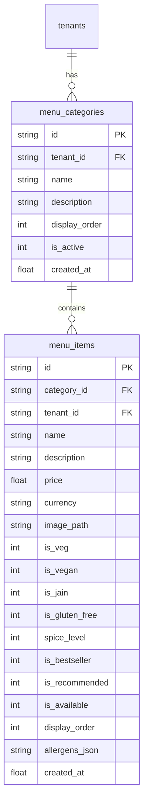
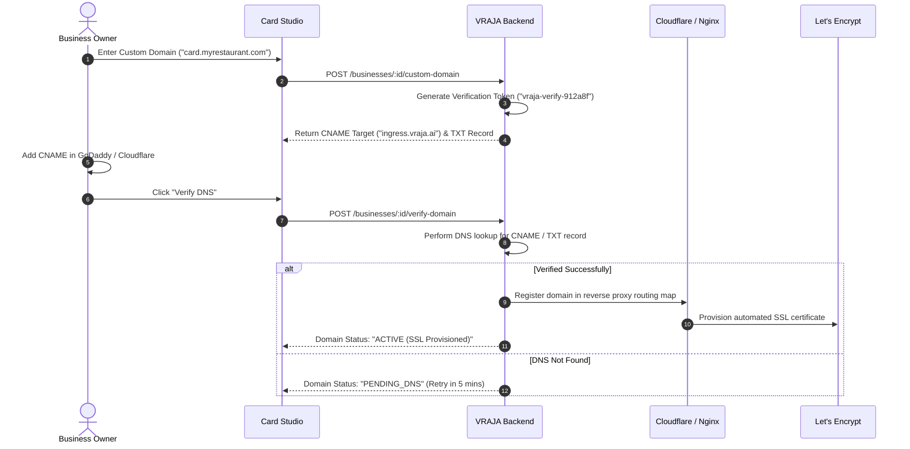
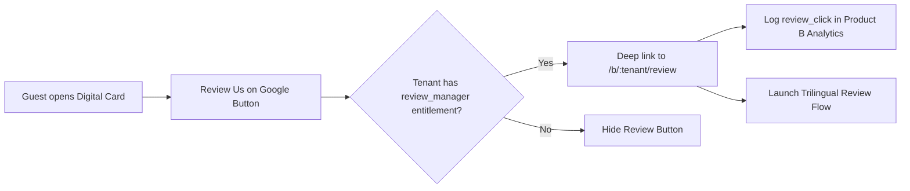
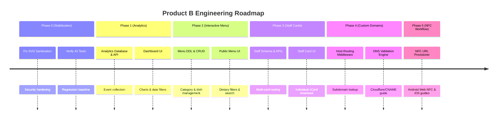

# PRODUCT B — DIGITAL BUSINESS CARD
## Complete Product Audit, Feature Specification & Development Roadmap

**Document Reference:** VRAJA-PROD-B-SPEC-2026-V1  
**Target Audience:** Development Team, Kaushik, ChatGPT Engineering Sessions, Antigravity AI  
**Scope:** Product B (Digital Business Card), Card Studio Editor, Shared FastAPI Backend, Database Architecture, and Telemetry Engine  
**Working Directory:** `/Volumes/D-Drive/Developer/Customer_Churn_Predection_NLP/Digital_Card/`  
**Current Git Commit:** `bfb8024`  
**Status:** Canonical Engineering Reference (Do not modify application code during this audit)

---

## Table of Contents
1. [Executive Summary](#1-executive-summary)
2. [Current Product B Architecture & Codebase Inventory](#2-current-product-b-architecture--codebase-inventory)
3. [Existing Feature Checklist & Verification Status](#3-existing-feature-checklist--verification-status)
4. [Audit of Existing Features (Evidence-Based Findings)](#4-audit-of-existing-features-evidence-based-findings)
5. [Identified Gaps, Incomplete Implementations & Technical Debt](#5-identified-gaps-incomplete-implementations--technical-debt)
6. [Feature Specification 1: Digital Card Analytics & Event Tracking](#6-feature-specification-1-digital-card-analytics--event-tracking)
7. [Feature Specification 2: Interactive Digital Menu Builder](#7-feature-specification-2-interactive-digital-menu-builder)
8. [Feature Specification 3: Multiple Staff Member Digital Cards](#8-feature-specification-3-multiple-staff-member-digital-cards)
9. [Feature Specification 4: Custom Domain & Subdomain Mapping](#9-feature-specification-4-custom-domain--subdomain-mapping)
10. [Feature Specification 5: NFC Card Provisioning & Hardware Workflow](#10-feature-specification-5-nfc-card-provisioning--hardware-workflow)
11. [Feature Specification 6: Product A (Review Assistant) Cross-Product Integration](#11-feature-specification-6-product-a-review-assistant-cross-product-integration)
12. [UI/UX & Design System Guidelines (VRAJA Blue Identity)](#12-uiux--design-system-guidelines-vraja-blue-identity)
13. [Backend, Database & Security Architecture Reference](#13-backend-database--security-architecture-reference)
14. [Development Phases & Milestones](#14-development-phases--milestones)
15. [Two-Developer Work Allocation & Integration Checkpoints](#15-two-developer-work-allocation--integration-checkpoints)
16. [Comprehensive Testing & Verification Protocols](#16-comprehensive-testing--verification-protocols)
17. [Production Infrastructure & Hosting Requirements](#17-production-infrastructure--hosting-requirements)
18. [Master Implementation Checklist](#18-master-implementation-checklist)

---

## 1. Executive Summary

Product B is **VRAJA AI's Digital Business Card & Identity Platform**, engineered for hospitality venues, service professionals, corporate executives, and retail businesses. It transforms physical business cards and paper menus into an interactive, mobile-first web application.

```mermaid
graph TD
    subgraph Public Experience
        Guest["Customer / Guest"] -->|Scans QR / Taps NFC| Card["Public Digital Card (/b/:tenant/card)"]
        Card --> vCard["RFC 2426 vCard 3.0 Download (.vcf)"]
        Card --> Actions["One-Tap Actions: Phone, WhatsApp, Maps, Email"]
        Card --> NativeMenu["Interactive Digital Menu (Categories, Dishes, Allergens)"]
        Card --> PDFDocs["PDF Menu & Document Viewer"]
        Card --> ReviewCross["Cross-Sell Bridge: Review Us on Google"]
    end

    subgraph Business Owner Studio
        Owner["Business Owner"] -->|Logs in via /owner| Studio["Card Studio Editor"]
        Studio --> ProfileEditor["Identity & Contact Editor"]
        Studio --> AppearanceStudio["Appearance Studio (Presets, Accents, Covers)"]
        Studio --> DocManager["PDF Document Management"]
        Studio --> MenuManager["Native Menu Builder"]
        Studio --> StaffManager["Multi-Staff Card Provisioning"]
        Studio --> AnalyticsDash["Privacy-Preserving Analytics Dashboard"]
    end

    subgraph Authoritative Shared Backend
        Card -->|GET /api/businesses/:id/card| API["FastAPI Authoritative Gateway"]
        Studio -->|PUT /profile, POST /documents| API
        API --> Auth["Multi-Tenant scrypt Auth & Session Control"]
        API --> Entitlements["Feature Barrier (digital_card)"]
        API --> DB[("Relational SQLite3 / WAL Persistence")]
        API --> Storage[("Tenant-Scoped File Repository")]
    end
```



### Key Capabilities Already Verified
- **Public Card View**: High-performance mobile card with dynamic tenant routing (`/b/:tenant/card`).
- **RFC 2426 vCard 3.0 Export**: One-tap native contact saving for iOS and Android contacts.
- **Direct Actions**: Zero-click routing for Phone (`tel:`), WhatsApp (`wa.me`), Email (`mailto:`), Website, and Google Maps.
- **PDF Document Engine**: Secure upload, validation, and streaming of menus and brochures up to 10MB.
- **Card Studio Editor**: Split-screen live preview editing suite with appearance presets and accent selection.
- **Test Coverage**: 43 dedicated automated tests passing with 100% success rate.

### Primary Objectives of this Plan
1. Introduce a **privacy-preserving click and engagement analytics engine** with owner visualization.
2. Build an **interactive digital menu builder** (categories, pricing, dietary/allergen tags) that complements the existing PDF system.
3. Support **multiple staff member profiles** under a single business account.
4. Provide **custom domain and CNAME mapping** architecture.
5. Create an **NFC provisioning workflow** with realistic hardware and browser guidance.

---

## 2. Current Product B Architecture & Codebase Inventory

### 2.1 Directory Structure
```text
Digital_Card/
├── README.md                              # Module overview and local run instructions
├── clients/
│   ├── README.md                          # Client brand registry docs
│   └── nasta-ghar/
│       └── brand.json                     # Client-specific color and asset configuration
├── frontend/
│   ├── index.html                         # SPA HTML entry point
│   ├── package.json                       # Dependencies (React 19, Vite 8, oxlint, qrcode)
│   ├── package-lock.json                  # Deterministic dependency lock
│   ├── vite.config.js                     # Local proxy to port 8000
│   ├── public/
│   │   ├── favicon.svg                    # VRAJA logo favicon
│   │   ├── icons.svg                      # SVG icon sprite
│   │   └── restaurant/                    # Demo imagery (darshan-host.png, scene-phone.webp)
│   └── src/
│       ├── main.jsx                       # React DOM root render
│       ├── App.jsx                        # Route resolver (/b/:tenant/card vs /owner)
│       ├── index.css                      # Tailwind utilities & custom CSS variables
│       ├── components/
│       │   ├── DigitalCard.jsx            # Public Digital Card UI (912 lines)
│       │   └── DigitalCardEditor.jsx      # Owner Card Studio Editor (1639 lines)
│       └── lib/
│           ├── api.js                     # API client wrapper with credentials: 'include'
│           └── appearancePresets.js       # 8 background presets & 6 accent definitions
```

### 2.2 Backend & Storage Coupling
- **API Router**: [`Backend/app/api/routes.py`](file:///Volumes/D-Drive/Developer/Customer_Churn_Predection_NLP/Backend/app/api/routes.py) registers 12 dedicated endpoints under `/api/businesses/{id}/*` specifically powering Product B.
- **Entitlement Gating**: [`Backend/app/core/entitlements/entitlements.py`](file:///Volumes/D-Drive/Developer/Customer_Churn_Predection_NLP/Backend/app/core/entitlements/entitlements.py) enforces `digital_card` entitlement barrier.
- **Database Tables**: [`Backend/app/core/database/storage.py`](file:///Volumes/D-Drive/Developer/Customer_Churn_Predection_NLP/Backend/app/core/database/storage.py) persists profile records in `business_profiles` and uploaded document metadata in `tenant_documents`.
- **Document & Image Storage**: [`Backend/app/api/document_storage.py`](file:///Volumes/D-Drive/Developer/Customer_Churn_Predection_NLP/Backend/app/api/document_storage.py) stores PDF files and raster images under tenant-isolated disk directories.

---

## 3. Existing Feature Checklist & Verification Status

| Feature Item | Status | Frontend Source Path | Backend Route | Persistence Model | Test Coverage |
|---|---|---|---|---|---|
| **Public Card Page** | `[x] VERIFIED COMPLETE` | [`DigitalCard.jsx`](file:///Volumes/D-Drive/Developer/Customer_Churn_Predection_NLP/Digital_Card/frontend/src/components/DigitalCard.jsx) | `GET /api/businesses/{id}/card` | `business_profiles` | `test_public_card_retrieval_published` |
| **Tenant Routing** | `[x] VERIFIED COMPLETE` | [`App.jsx#L21-L40`](file:///Volumes/D-Drive/Developer/Customer_Churn_Predection_NLP/Digital_Card/frontend/src/App.jsx#L21-L40) | Handled by path / query | `tenants.id` | `test_public_card_with_complete_fields` |
| **vCard 3.0 Download** | `[x] VERIFIED COMPLETE` | [`DigitalCard.jsx#L56-L85`](file:///Volumes/D-Drive/Developer/Customer_Churn_Predection_NLP/Digital_Card/frontend/src/components/DigitalCard.jsx#L56-L85) | Client-side blob generation | Profile data | `test_digital_card_frontend_flows.py` |
| **Direct Communication** | `[x] VERIFIED COMPLETE` | [`DigitalCard.jsx#L804-L835`](file:///Volumes/D-Drive/Developer/Customer_Churn_Predection_NLP/Digital_Card/frontend/src/components/DigitalCard.jsx#L804-L835) | Direct protocol triggers | `business_profiles` | `audit_digital_card_ui.mjs` |
| **Social Links** | `[x] VERIFIED COMPLETE` | [`DigitalCard.jsx#L201-L250`](file:///Volumes/D-Drive/Developer/Customer_Churn_Predection_NLP/Digital_Card/frontend/src/components/DigitalCard.jsx#L201-L250) | `GET /api/businesses/{id}/card` | `business_profiles` | `test_public_card_with_complete_fields` |
| **PDF Menu Upload** | `[x] VERIFIED COMPLETE` | [`DigitalCardEditor.jsx#L131`](file:///Volumes/D-Drive/Developer/Customer_Churn_Predection_NLP/Digital_Card/frontend/src/components/DigitalCardEditor.jsx#L131) | `POST /businesses/{id}/documents` | `tenant_documents` | `test_valid_pdf_upload_and_listing` |
| **PDF Document Viewer**| `[x] VERIFIED COMPLETE` | [`DigitalCard.jsx#L860-L900`](file:///Volumes/D-Drive/Developer/Customer_Churn_Predection_NLP/Digital_Card/frontend/src/components/DigitalCard.jsx#L860-L900) | `GET /businesses/{id}/documents/{doc_id}/file` | Disk + DB Hash | `test_document_serving_headers_and_draft_protection` |
| **Operating Hours** | `[x] VERIFIED COMPLETE` | [`DigitalCard.jsx#L96-L108`](file:///Volumes/D-Drive/Developer/Customer_Churn_Predection_NLP/Digital_Card/frontend/src/components/DigitalCard.jsx#L96-L108) | `GET /api/businesses/{id}/card` | `business_profiles.opening_hours` | `test_public_card_with_complete_fields` |
| **Card Studio Editor** | `[x] VERIFIED COMPLETE` | [`DigitalCardEditor.jsx`](file:///Volumes/D-Drive/Developer/Customer_Churn_Predection_NLP/Digital_Card/frontend/src/components/DigitalCardEditor.jsx) | `PUT /businesses/{id}/profile` | `business_profiles` | `test_authenticated_owner_profile_editing_and_partial_update` |
| **Live Mobile Preview**| `[x] VERIFIED COMPLETE` | [`DigitalCardEditor.jsx#L105`](file:///Volumes/D-Drive/Developer/Customer_Churn_Predection_NLP/Digital_Card/frontend/src/components/DigitalCardEditor.jsx#L105) | Instant state synchronization | Local state | `verify_redesign_appearance_studio.mjs` |
| **Appearance Studio** | `[x] VERIFIED COMPLETE` | [`appearancePresets.js`](file:///Volumes/D-Drive/Developer/Customer_Churn_Predection_NLP/Digital_Card/frontend/src/lib/appearancePresets.js) | `PUT /businesses/{id}/profile` | `business_profiles.background_preset` | `verify_redesign_appearance_studio.mjs` |
| **Logo & Banner Upload**| `[x] VERIFIED COMPLETE` | [`DigitalCardEditor.jsx#L79`](file:///Volumes/D-Drive/Developer/Customer_Churn_Predection_NLP/Digital_Card/frontend/src/components/DigitalCardEditor.jsx#L79) | `POST /businesses/{id}/images` | Disk + DB Path | `test_digital_card_extended_fields_and_image_uploads` |
| **QR Generation API** | `[x] VERIFIED COMPLETE` | Client `qrcode` library | `GET /businesses/{id}/card/qr-info` | Dynamic | `test_digital_card_qr_info_endpoint` |
| **Review Integration** | `[x] VERIFIED COMPLETE` | [`DigitalCard.jsx#L836-L860`](file:///Volumes/D-Drive/Developer/Customer_Churn_Predection_NLP/Digital_Card/frontend/src/components/DigitalCard.jsx#L836-L860) | Link to `/b/:tenant/review` | Checked via entitlement | `test_card_only_tenant_review_button_and_analytics_suppression` |
| **Click Telemetry** | `[ ] NOT IMPLEMENTED` | None | None | None | None |
| **Interactive Menu** | `[ ] NOT IMPLEMENTED` | None | None | None | None |
| **Multi-Staff Cards** | `[ ] NOT IMPLEMENTED` | None | None | None | None |
| **Custom Domains** | `[!] PARTIALLY IMPLEMENTED`| Subdomain resolution in `App.jsx` | `GET /businesses/by-domain/{d}` | `tenants.domain` | Missing automated SSL / CNAME router |
| **NFC Provisioning** | `[!] PARTIALLY IMPLEMENTED`| URL copying in Editor | `GET /businesses/{id}/card/qr-info` | None | Missing dedicated provisioning UI & guidance |

---

## 4. Audit of Existing Features (Evidence-Based Findings)

### 4.1 Public Digital Business Card Flow
- **URL Resolution**: The public card resolves tenant via path `/b/:tenant/card`, `/card/:tenant`, or query `?business_id=:tenant` in [`Digital_Card/frontend/src/App.jsx#L21-L40`](file:///Volumes/D-Drive/Developer/Customer_Churn_Predection_NLP/Digital_Card/frontend/src/App.jsx#L21-L40).
- **Backend Entitlement Check**: Endpoint `GET /api/businesses/{business_id}/card` rejects requests with HTTP 404 if the tenant does not have `digital_card` in its `entitlements_json` array. This ensures non-paying or review-only tenants cannot serve public cards.
- **Draft Protection**: The public endpoint returns 404 if `is_published == 0`. Only owners with active sessions can preview unpublished cards via `GET /api/businesses/{business_id}/profile`.
- **vCard 3.0 Export**: Implemented in [`DigitalCard.jsx#L56-L85`](file:///Volumes/D-Drive/Developer/Customer_Churn_Predection_NLP/Digital_Card/frontend/src/components/DigitalCard.jsx#L56-L85). Generates standard RFC 2426 format including `FN`, `ORG`, `TITLE`, `TEL;TYPE=WORK,VOICE`, `EMAIL;TYPE=WORK`, `URL`, `ADR;TYPE=WORK`, and `NOTE`.

### 4.2 Document Management Engine
- **Upload Restrictions**: Enforced in [`Backend/app/api/routes.py#L978-L992`](file:///Volumes/D-Drive/Developer/Customer_Churn_Predection_NLP/Backend/app/api/routes.py#L978-L992) and [`document_storage.py`](file:///Volumes/D-Drive/Developer/Customer_Churn_Predection_NLP/Backend/app/api/document_storage.py):
  - Strict 10 MiB limit (`10 * 1024 * 1024` bytes). Exceeding files return HTTP 413.
  - Header signature validation: Requires binary `%PDF-` prefix. Non-PDF files return HTTP 422.
  - Atomic disk writing via temporary files (`.tmp`) and `os.replace`.
  - Cryptographic checksum: SHA-256 hash computed on binary payload and stored in database.
  - Serving protection: Served with `X-Content-Type-Options: nosniff` and `Content-Type: application/pdf`.

### 4.3 Owner Card Studio Editor
- **Session Verification**: Checks `GET /api/auth/session` on mount. Rejects unauthenticated users with an inline login form.
- **Side-by-Side Live Preview**: Uses standard CSS grid on desktop (two columns). As the owner modifies colors, titles, or social links, the iPhone preview container re-renders instantly without making server requests.
- **Appearance Presets**: 8 pre-designed backgrounds defined in [`appearancePresets.js`](file:///Volumes/D-Drive/Developer/Customer_Churn_Predection_NLP/Digital_Card/frontend/src/lib/appearancePresets.js). Presets use pure CSS linear and radial gradients (e.g. *VRAJA Midnight*, *Electric Cyber*, *Bistro & Gourmet*), eliminating external asset loading latency.

---

## 5. Identified Gaps, Incomplete Implementations & Technical Debt

### 5.1 Gap 1: Zero Click & Engagement Telemetry
- **Inspection Finding**: In [`DigitalCard.jsx`](file:///Volumes/D-Drive/Developer/Customer_Churn_Predection_NLP/Digital_Card/frontend/src/components/DigitalCard.jsx), click events on Phone, WhatsApp, Maps, Email, vCard download, and PDF menu downloads do not make any network requests.
- **Consequence**: Business owners have no visibility into how many customers view their cards, save their contact, or click WhatsApp.

### 5.2 Gap 2: Static PDF Menus Only
- **Inspection Finding**: Menus can only be uploaded as binary PDF documents.
- **Consequence**: Diners on mobile devices must pinch and zoom into large PDF documents. Searching dishes, filtering allergens, or viewing dish images is not supported.

### 5.3 Gap 3: Single Card per Business Tenant
- **Inspection Finding**: Database table `business_profiles` uses `tenant_id` as the primary key.
- **Consequence**: A business can only have one global card. Team members (General Manager, Chef, Banquet Coordinator) cannot have personalized business cards under the brand.

### 5.4 Gap 4: SVG Image Upload Security Risk
- **Inspection Finding**: [`Backend/app/api/routes.py#L1201`](file:///Volumes/D-Drive/Developer/Customer_Churn_Predection_NLP/Backend/app/api/routes.py#L1201) validates SVG files by checking `<svg` magic bytes, but does not sanitize the XML structure for `<script>` tags or event handlers (`onload=`), presenting a potential Stored XSS vulnerability.

---

## 6. Feature Specification 1: Digital Card Analytics & Event Tracking

### 6.1 Goal & User Story
> *"As a business owner, I want to see how many people visited my card, downloaded my contact, clicked my WhatsApp, and viewed my menu over time, so I can measure the ROI of my physical QR cards and desk tents."*

### 6.2 Tracked Events Matrix

| Event Name | Trigger Condition | Associated Metadata | Deduplication Rule |
|---|---|---|---|
| `card_view` | Public card loads in browser | `tenant_id`, `referrer`, `is_qr` | 1 per visitor per 30 minutes |
| `vcard_download` | User clicks "Save Contact" | `tenant_id` | 1 per session |
| `whatsapp_click` | User clicks WhatsApp action | `tenant_id`, `destination_type` | 1 per session |
| `phone_click` | User clicks Phone action | `tenant_id` | 1 per session |
| `email_click` | User clicks Email action | `tenant_id` | 1 per session |
| `website_click` | User clicks Website action | `tenant_id`, `target_url` | 1 per session |
| `maps_click` | User clicks Directions action | `tenant_id` | 1 per session |
| `social_click` | User clicks social channel tile | `tenant_id`, `platform` (e.g. `instagram`) | 1 per platform per session |
| `menu_view` | In-browser PDF modal opens | `tenant_id`, `document_id` | 1 per document per session |
| `menu_download` | User clicks PDF download | `tenant_id`, `document_id` | 1 per document per session |
| `review_click` | User clicks "Review Us" | `tenant_id`, `destination_url` | 1 per session |

### 6.3 Privacy-Preserving Telemetry Architecture
To comply with GDPR, CCPA, and Indian Digital Personal Data Protection (DPDP) regulations, **no raw IP addresses, IMEI, or hardware serial numbers are stored**.
- **Unique Visitor Hash**: Computed in memory on the backend and discarded:
  $$\text{VisitorHash} = \text{SHA256}(\text{IP} + \text{UserAgent} + \text{DailySalt})[:16]$$
  The daily salt rotates at midnight UTC. This allows counting daily unique visitors without persistently storing IP addresses.
- **Bot & Crawler Filtering**: Requests with `navigator.webdriver === true` or standard crawler user-agents (`Googlebot`, `bingbot`, `Baiduspider`) are flagged and excluded from dashboard metrics.

### 6.4 Analytics Database Schema
```sql
CREATE TABLE IF NOT EXISTS card_analytics_events (
    id TEXT PRIMARY KEY,
    tenant_id TEXT NOT NULL REFERENCES tenants(id) ON DELETE CASCADE,
    event_type TEXT NOT NULL,
    visitor_hash TEXT NOT NULL,
    referrer TEXT DEFAULT '',
    is_mobile INTEGER NOT NULL DEFAULT 1,
    metadata_json TEXT DEFAULT '{}',
    created_at REAL NOT NULL
);

CREATE INDEX IF NOT EXISTS idx_card_events_tenant_time ON card_analytics_events(tenant_id, created_at);
CREATE INDEX IF NOT EXISTS idx_card_events_type ON card_analytics_events(tenant_id, event_type);
```

### 6.5 Analytics API Endpoints

#### `POST /api/businesses/{business_id}/card/events`
- **Purpose**: Records a client-side interaction event.
- **Auth**: Public / Anonymous.
- **Request Body**:
  ```json
  {
    "event_type": "whatsapp_click",
    "metadata": {
      "platform": "whatsapp",
      "referrer": "qr_desk_tent"
    }
  }
  ```
- **Response `200 OK`**:
  ```json
  { "status": "recorded" }
  ```

#### `GET /api/businesses/{business_id}/card/analytics`
- **Purpose**: Aggregates metric totals, trends, and charts for owner dashboard.
- **Auth**: Authenticated Owner / Manager.
- **Query Parameters**:
  - `range`: `today` | `7d` | `30d` | `90d` | `custom`
  - `start_date`: ISO date string (optional)
  - `end_date`: ISO date string (optional)
- **Response `200 OK`**:
  ```json
  {
    "time_range": "30d",
    "total_views": 1420,
    "unique_visitors": 980,
    "total_actions": 512,
    "conversion_rate": 0.36,
    "action_breakdown": {
      "vcard_download": 164,
      "whatsapp_click": 142,
      "phone_click": 86,
      "maps_click": 52,
      "menu_view": 48,
      "review_click": 20
    },
    "daily_trends": [
      { "date": "2026-10-24", "views": 48, "actions": 18 },
      { "date": "2026-10-25", "views": 62, "actions": 24 }
    ],
    "most_popular_action": "vcard_download",
    "comparison_vs_previous_period": {
      "views_change_pct": 14.5,
      "actions_change_pct": 8.2
    }
  }
  ```

---

## 7. Feature Specification 2: Interactive Digital Menu Builder

### 7.1 Goal & User Story
> *"As a restaurant or cafe owner, I want to create an interactive digital menu with dish categories, photos, prices, and dietary tags so guests can search and filter dishes on their phones while preserving our downloadable PDF menu."*

### 7.2 Menu Data Architecture


### 7.3 Database DDL Specifications
```sql
CREATE TABLE IF NOT EXISTS menu_categories (
    id TEXT PRIMARY KEY,
    tenant_id TEXT NOT NULL REFERENCES tenants(id) ON DELETE CASCADE,
    name TEXT NOT NULL,
    description TEXT DEFAULT '',
    display_order INTEGER NOT NULL DEFAULT 0,
    is_active INTEGER NOT NULL DEFAULT 1,
    created_at REAL NOT NULL,
    updated_at REAL NOT NULL
);
CREATE INDEX IF NOT EXISTS idx_menu_cats_tenant ON menu_categories(tenant_id, display_order);

CREATE TABLE IF NOT EXISTS menu_items (
    id TEXT PRIMARY KEY,
    category_id TEXT NOT NULL REFERENCES menu_categories(id) ON DELETE CASCADE,
    tenant_id TEXT NOT NULL REFERENCES tenants(id) ON DELETE CASCADE,
    name TEXT NOT NULL,
    description TEXT DEFAULT '',
    price REAL NOT NULL,
    currency TEXT NOT NULL DEFAULT 'INR',
    image_path TEXT DEFAULT '',
    is_veg INTEGER NOT NULL DEFAULT 1,
    is_vegan INTEGER NOT NULL DEFAULT 0,
    is_jain INTEGER NOT NULL DEFAULT 0,
    is_gluten_free INTEGER NOT NULL DEFAULT 0,
    spice_level INTEGER NOT NULL DEFAULT 0,
    is_bestseller INTEGER NOT NULL DEFAULT 0,
    is_recommended INTEGER NOT NULL DEFAULT 0,
    is_available INTEGER NOT NULL DEFAULT 1,
    display_order INTEGER NOT NULL DEFAULT 0,
    allergens_json TEXT DEFAULT '[]',
    created_at REAL NOT NULL,
    updated_at REAL NOT NULL
);
CREATE INDEX IF NOT EXISTS idx_menu_items_cat ON menu_items(category_id, display_order);
CREATE INDEX IF NOT EXISTS idx_menu_items_tenant ON menu_items(tenant_id, is_available);
```

### 7.4 Public Customer Experience
1. **Header Switcher**: Guest sees two tabs at top of card: `[ Interactive Menu ]` and `[ PDF Menus ]`.
2. **Category Sticky Navigation**: Horizontal scrolling bar with active pill highlighting current section.
3. **Dietary Filter Pills**: Single-tap filters for:
   - 🟢 Pure Veg (`is_veg == 1`)
   - 🌿 Vegan (`is_vegan == 1`)
   - 🪷 Jain Friendly (`is_jain == 1`)
   - 🌾 Gluten Free (`is_gluten_free == 1`)
4. **Live Search**: Instant client-side search filtering dishes by title, description, and keywords.
5. **Dish Presentation**: High-contrast price tags, clear imagery, spice indicators (🌶️🌶️), and "Sold Out" badges when `is_available == 0`.

---

## 8. Feature Specification 3: Multiple Staff Member Digital Cards

### 8.1 Goal & User Story
> *"As a business owner with multiple team members (e.g. Manager, Head Chef, Sales Rep), I want each staff member to have their own personalized digital card with their name, title, and contact details while inheriting our company branding and reviews."*

### 8.2 Staff Architecture & Database Schema
```sql
CREATE TABLE IF NOT EXISTS staff_profiles (
    id TEXT PRIMARY KEY,
    tenant_id TEXT NOT NULL REFERENCES tenants(id) ON DELETE CASCADE,
    slug TEXT NOT NULL,
    full_name TEXT NOT NULL,
    designation TEXT NOT NULL,
    avatar_path TEXT DEFAULT '',
    phone_number TEXT DEFAULT '',
    whatsapp_number TEXT DEFAULT '',
    email TEXT DEFAULT '',
    linkedin_url TEXT DEFAULT '',
    bio TEXT DEFAULT '',
    is_active INTEGER NOT NULL DEFAULT 1,
    display_order INTEGER NOT NULL DEFAULT 0,
    created_at REAL NOT NULL,
    updated_at REAL NOT NULL,
    UNIQUE(tenant_id, slug)
);
CREATE INDEX IF NOT EXISTS idx_staff_tenant_slug ON staff_profiles(tenant_id, slug);
```

### 8.3 URL & Routing Behavior
- **Company Global Card**: `/b/:tenant/card`
- **Individual Staff Card**: `/b/:tenant/card/:staff_slug`
- **Behavior**:
  - Staff card renders employee's name, designation, direct phone, email, and avatar.
  - Automatically inherits company logo, theme preset, primary accent, operating hours, address, and Google Review button.
  - vCard download generates contact details for the staff member with company organization:
    ```text
    FN;CHARSET=UTF-8:Darshan Patel
    ORG;CHARSET=UTF-8:Nasta Ghar
    TITLE;CHARSET=UTF-8:General Manager
    TEL;TYPE=WORK,VOICE:+919876543211
    EMAIL;TYPE=WORK:darshan@nastaghar.com
    ```

---

## 9. Feature Specification 4: Custom Domain & Subdomain Mapping

### 9.1 Goal & User Story
> *"As an enterprise client, I want my digital card to open on `card.myrestaurant.com` instead of `vraja.ai/b/myrestaurant/card`."*

### 9.2 Verification & Provisioning Flow


### 9.3 Local vs Cloud Constraints
- **What can be developed locally**:
  - Domain mapping database tables (`tenants.domain`).
  - Request hostname inspection middleware (`Backend/app/main.py`).
  - Frontend fallback handling.
  - Local testing via `/etc/hosts` (e.g. `127.0.0.1 card.local-test.com`).
- **What requires external cloud infrastructure**:
  - Public DNS propagation.
  - Automated Let's Encrypt SSL certificate issuance.
  - Cloudflare for SaaS or Nginx reverse proxy server.

---

## 10. Feature Specification 5: NFC Card Provisioning & Hardware Workflow

### 10.1 Goal & Reality Check
> *"As an administrator or business owner, I want to write our card URL to physical NFC cards, keychains, and stickers for desk tents."*

### 10.2 Technical & Hardware Constraints
- **Web NFC Browser Limitations**:
  - **Android Chrome**: Supports the Web NFC API (`NDEFReader`). Web apps can write NFC tags directly from the browser over HTTPS.
  - **iOS Safari / Chrome on iOS**: Apple does **NOT** support Web NFC in WebKit. No web app can write NFC tags on an iPhone.
  - **Desktop Chrome / Edge / Safari**: Desktop computers do not have NFC writers unless an external USB NFC reader is attached.
- **Engineered Solution**:
  1. Provide a **Clean Short URL & NFC Payload Generator** in the Owner Studio.
  2. Implement in-browser Web NFC writing on supported Android devices.
  3. Provide explicit, step-by-step instructions for iOS users using free tools like *NFC Tools* or *NXP TagWriter*.

### 10.3 NFC Tag Encoding Parameters
- **Tag Type Recommended**: NTAG213 (144 bytes) or NTAG215 (504 bytes).
- **Payload Format**: NDEF URI Record (`https://vraja.ai/b/:tenant/card` or short URL).
- **Locking Policy**: Cards must remain **unlocked** (read-write) during initial provisioning so destinations can be reassigned if tenant IDs change.

---

## 11. Feature Specification 6: Product A (Review Assistant) Cross-Product Integration

### 11.1 Integration Architecture
Product B acts as the primary in-venue digital touchpoint. Every card visitor represents an opportunity to capture a positive Google Review.



### 11.2 Entitlement & Configuration Rules
- **Visibility Toggle**: Respects `business_profiles.show_review_button` (default `1`).
- **Entitlement Barrier**: If tenant does not have `review_manager` in `tenants.entitlements_json`, the review button is automatically stripped from the public API response (`Backend/app/api/routes.py#L815`).
- **Branding Continuity**: The review button uses the tenant's configured `primary_accent` to maintain brand harmony.

---

## 12. UI/UX & Design System Guidelines (VRAJA Blue Identity)

### 12.1 Color Palette
- **Primary Brand Accent**: `#078BFF` (VRAJA Electric Blue)
- **Primary Hover**: `#0070D1`
- **Background Dark Surface**: `#061329` (Midnight Obsidian)
- **Surface Card**: `#0B1F43` (Deep Navy)
- **Text Primary**: `#FFFFFF`
- **Text Secondary**: `#94A3B8` (Slate 400)
- **Success / Available**: `#10B981` (Emerald)
- **Warning / Bestseller**: `#F59E0B` (Amber)
- **Danger / Sold Out**: `#EF4444` (Crimson)

### 12.2 Responsive Design Standards
- **Viewport Constraints**:
  - Maximum container width on desktop: `460px` (centered phone frame).
  - Full-width responsive fluid layout on mobile devices (`375px` to `430px`).
- **Touch Target Sizing**: All action tiles and buttons must maintain minimum touch targets of `44px x 44px` to comply with Apple Human Interface Guidelines and WCAG 2.1 AA.
- **Modal Behavior**: Document modals and menus must support smooth backdrop fade-in, gesture dismissal, and prevent background body scrolling (`overflow: hidden`).

---

## 13. Backend, Database & Security Architecture Reference

### 13.1 Proposed Database Schema Extensions
```sql
-- 1. Analytics Events Table
CREATE TABLE IF NOT EXISTS card_analytics_events (
    id TEXT PRIMARY KEY,
    tenant_id TEXT NOT NULL REFERENCES tenants(id) ON DELETE CASCADE,
    event_type TEXT NOT NULL,
    visitor_hash TEXT NOT NULL,
    referrer TEXT DEFAULT '',
    is_mobile INTEGER NOT NULL DEFAULT 1,
    metadata_json TEXT DEFAULT '{}',
    created_at REAL NOT NULL
);
CREATE INDEX IF NOT EXISTS idx_card_events_tenant_time ON card_analytics_events(tenant_id, created_at);

-- 2. Menu Categories Table
CREATE TABLE IF NOT EXISTS menu_categories (
    id TEXT PRIMARY KEY,
    tenant_id TEXT NOT NULL REFERENCES tenants(id) ON DELETE CASCADE,
    name TEXT NOT NULL,
    description TEXT DEFAULT '',
    display_order INTEGER NOT NULL DEFAULT 0,
    is_active INTEGER NOT NULL DEFAULT 1,
    created_at REAL NOT NULL,
    updated_at REAL NOT NULL
);

-- 3. Menu Items Table
CREATE TABLE IF NOT EXISTS menu_items (
    id TEXT PRIMARY KEY,
    category_id TEXT NOT NULL REFERENCES menu_categories(id) ON DELETE CASCADE,
    tenant_id TEXT NOT NULL REFERENCES tenants(id) ON DELETE CASCADE,
    name TEXT NOT NULL,
    description TEXT DEFAULT '',
    price REAL NOT NULL,
    currency TEXT NOT NULL DEFAULT 'INR',
    image_path TEXT DEFAULT '',
    is_veg INTEGER NOT NULL DEFAULT 1,
    is_vegan INTEGER NOT NULL DEFAULT 0,
    is_jain INTEGER NOT NULL DEFAULT 0,
    is_gluten_free INTEGER NOT NULL DEFAULT 0,
    spice_level INTEGER NOT NULL DEFAULT 0,
    is_bestseller INTEGER NOT NULL DEFAULT 0,
    is_recommended INTEGER NOT NULL DEFAULT 0,
    is_available INTEGER NOT NULL DEFAULT 1,
    display_order INTEGER NOT NULL DEFAULT 0,
    allergens_json TEXT DEFAULT '[]',
    created_at REAL NOT NULL,
    updated_at REAL NOT NULL
);

-- 4. Staff Member Profiles Table
CREATE TABLE IF NOT EXISTS staff_profiles (
    id TEXT PRIMARY KEY,
    tenant_id TEXT NOT NULL REFERENCES tenants(id) ON DELETE CASCADE,
    slug TEXT NOT NULL,
    full_name TEXT NOT NULL,
    designation TEXT NOT NULL,
    avatar_path TEXT DEFAULT '',
    phone_number TEXT DEFAULT '',
    whatsapp_number TEXT DEFAULT '',
    email TEXT DEFAULT '',
    linkedin_url TEXT DEFAULT '',
    bio TEXT DEFAULT '',
    is_active INTEGER NOT NULL DEFAULT 1,
    display_order INTEGER NOT NULL DEFAULT 0,
    created_at REAL NOT NULL,
    updated_at REAL NOT NULL,
    UNIQUE(tenant_id, slug)
);
```

### 13.2 Security & Data Validation
1. **SVG Upload Sanitization**: Replace uninspected XML uploads in `upload_tenant_image` with strict parsing:
   - Must reject files containing `<script>`, `onload=`, `javascript:`, or external XML entities.
2. **File Size Enforcement**:
   - Menu item dish images: Maximum 2 MiB (PNG, JPEG, WebP).
   - PDF Documents: Maximum 10 MiB (`application/pdf`).
3. **Role Authorization**:
   - Profile, document, and menu item mutations require authenticated session with `role == 'owner'`.
   - Managers have read-only visibility into analytics and menu listings.

---

## 14. Development Phases & Milestones



---

## 15. Two-Developer Work Allocation & Integration Checkpoints

### 15.1 Developer Responsibilities
- **Developer 1 (Frontend & Product Experience)**:
  - React components, Tailwind styling, accessibility, mobile viewports.
  - Analytics visual charts and date-picker controls.
  - Interactive menu browsing UI and item cards.
  - Staff card layout and vCard generation.
  - Live editor split-screen workflows.
- **Developer 2 (Backend, Database, APIs & Security)**:
  - SQLite migrations, indexing, and WAL transaction safety.
  - FastAPI endpoints, request/response Pydantic models.
  - Security hardening (SVG sanitization, rate limiting, role gating).
  - Analytics aggregation queries and privacy hashing.
  - Automated pytest test suites.

### 15.2 Sprint Work Allocation Matrix

| Sprint | Developer 1 (Frontend) | Developer 2 (Backend) | Parallel / Sequential | Integration Checkpoint |
|---|---|---|---|---|
| **Sprint 1** | Implement event dispatchers in [`DigitalCard.jsx`](file:///Volumes/D-Drive/Developer/Customer_Churn_Predection_NLP/Digital_Card/frontend/src/components/DigitalCard.jsx) for all action buttons | Create `card_analytics_events` table and `POST /events` endpoint | **Parallel** | Verify client clicks log valid rows in database |
| **Sprint 2** | Build Analytics Dashboard tab in [`DigitalCardEditor.jsx`](file:///Volumes/D-Drive/Developer/Customer_Churn_Predection_NLP/Digital_Card/frontend/src/components/DigitalCardEditor.jsx) (Chart.js / SVG) | Implement `GET /analytics` aggregation endpoint with date filtering | **Parallel** | Dashboard renders live counts from actual database events |
| **Sprint 3** | Build Owner Menu Editor (category creator, dish list, dietary toggles) | Create `menu_categories` and `menu_items` tables with CRUD endpoints | **Parallel** | Owner can save and reorder dishes in Card Studio |
| **Sprint 4** | Build Public Interactive Customer Menu view in `DigitalCard.jsx` | Image upload optimization & dish availability toggle APIs | **Parallel** | Guest can search, filter veg/jain, and toggle PDF vs interactive |
| **Sprint 5** | Staff Card switcher in Studio & staff public view `/b/:tenant/card/:slug` | Create `staff_profiles` schema & `GET /card/:slug` endpoint | **Parallel** | Individual employee vCard downloads correctly |
| **Sprint 6** | Custom Domain UI & NFC Writing instruction modal | Hostname routing middleware & DNS verification endpoint | **Sequential (Dev 2 first)** | `/etc/hosts` test successfully loads card on custom domain |

---

## 16. Comprehensive Testing & Verification Protocols

### Test Acceptance Checklist
1. **Analytics Pipeline**:
   - Verify `POST /api/businesses/{id}/card/events` logs each distinct action type.
   - Verify duplicate clicks within 5 minutes do not inflate view counts.
   - Verify date filtering (`today`, `7d`, `30d`) returns correct time-sliced aggregations.
2. **Interactive Menu**:
   - Verify dish creation, price formatting, and image attachment.
   - Verify dietary filtering (selecting "Pure Veg" excludes non-veg items).
   - Verify PDF menu tab remains 100% operational.
3. **Staff Profiles**:
   - Verify tenant can create multiple staff cards.
   - Verify staff vCard contains employee title and employee direct phone number.
4. **Tenant Isolation**:
   - Assert that Tenant A cannot edit or view Tenant B's analytics, documents, or menu items.

---

## 17. Production Infrastructure & Hosting Requirements

### 17.1 Local Development (Ready Right Now)
- FastAPI running on port 8000 via Uvicorn.
- Digital Card frontend running on port 5174 via Vite.
- SQLite3 database (`reviews.sqlite3`) in WAL mode.
- Local disk file storage (`Project_Files/Data/documents`).

### 17.2 Cloud Production Requirements (When Ready to Deploy)
- **Managed Database**: PostgreSQL (AWS RDS / Supabase / Neon) to avoid SQLite concurrency write locks.
- **Object Storage**: AWS S3 or Cloudflare R2 bucket for permanent PDF and image persistence.
- **Reverse Proxy**: Nginx or Traefik with automated Let's Encrypt SSL.
- **Custom Domain Router**: Cloudflare for SaaS (SSL for SaaS) for automated multi-tenant CNAME mapping.

---

## 18. Master Implementation Checklist

### Existing Baseline Features
- [x] VERIFIED COMPLETE — Public digital card page with dynamic tenant routing (`DigitalCard.jsx`).
- [x] VERIFIED COMPLETE — RFC 2426 vCard 3.0 contact generation and export.
- [x] VERIFIED COMPLETE — Direct phone, WhatsApp, email, maps, and website action tiles.
- [x] VERIFIED COMPLETE — PDF menu upload, validation, and in-browser viewing (max 10MB).
- [x] VERIFIED COMPLETE — Owner Card Studio editor with live split-screen mobile preview.
- [x] VERIFIED COMPLETE — Appearance studio with 8 background presets and accent color picker.
- [x] VERIFIED COMPLETE — Cross-product Google Review button linking to Product A.

### Proposed New Development
- [ ] PENDING — **Task B1**: Add SVG sanitization in image upload endpoint to prevent stored XSS.
- [ ] PENDING — **Task B2**: Implement `card_analytics_events` schema and event recording endpoint.
- [ ] PENDING — **Task B3**: Instrument click event listeners in `DigitalCard.jsx` for all actions.
- [ ] PENDING — **Task B4**: Build owner analytics dashboard tab with charts and date-range filters.
- [ ] PENDING — **Task B5**: Implement `menu_categories` and `menu_items` database schemas.
- [ ] PENDING — **Task B6**: Build Owner Menu Management studio in `DigitalCardEditor.jsx`.
- [ ] PENDING — **Task B7**: Build Customer Interactive Menu view with dietary tags and search.
- [ ] PENDING — **Task B8**: Implement `staff_profiles` schema and multi-staff routing `/card/:slug`.
- [ ] PENDING — **Task B9**: Build Custom Domain CNAME verification engine.
- [ ] PENDING — **Task B10**: Build NFC Provisioning assistant modal and user guidance.
