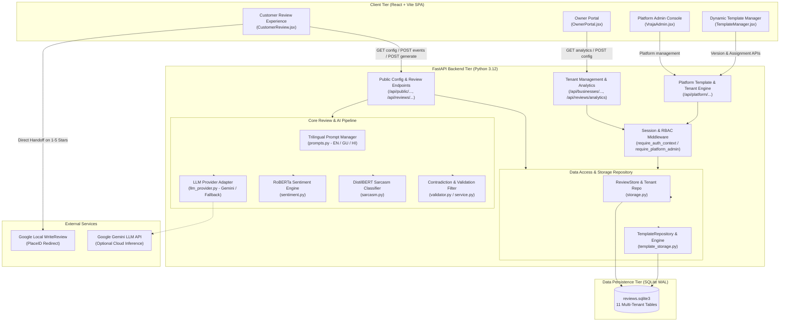
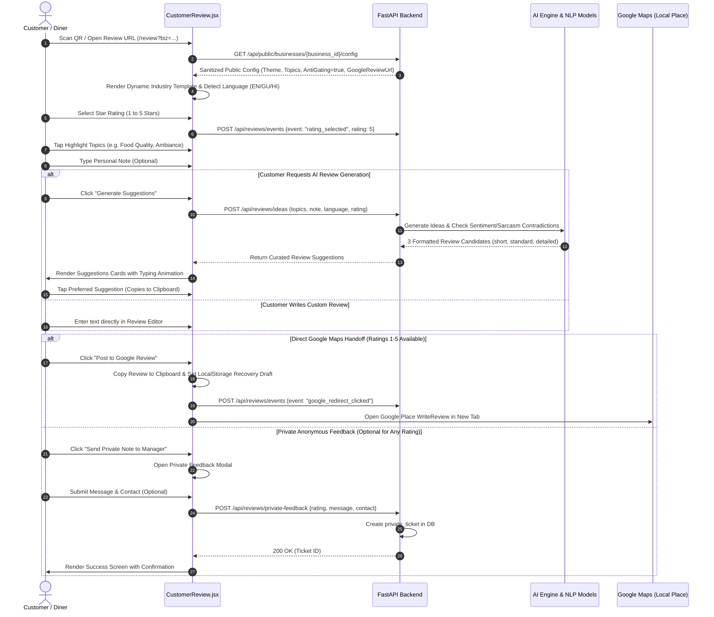
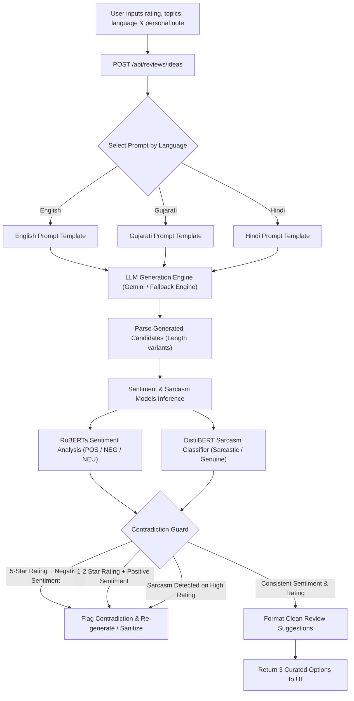
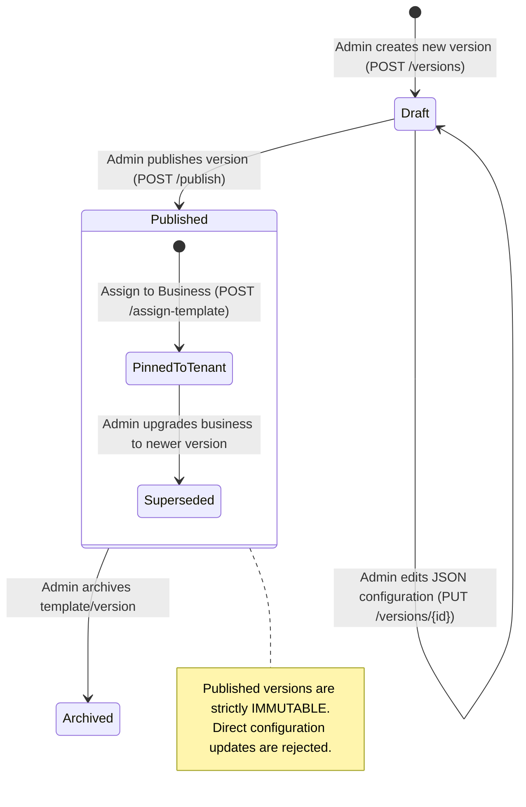
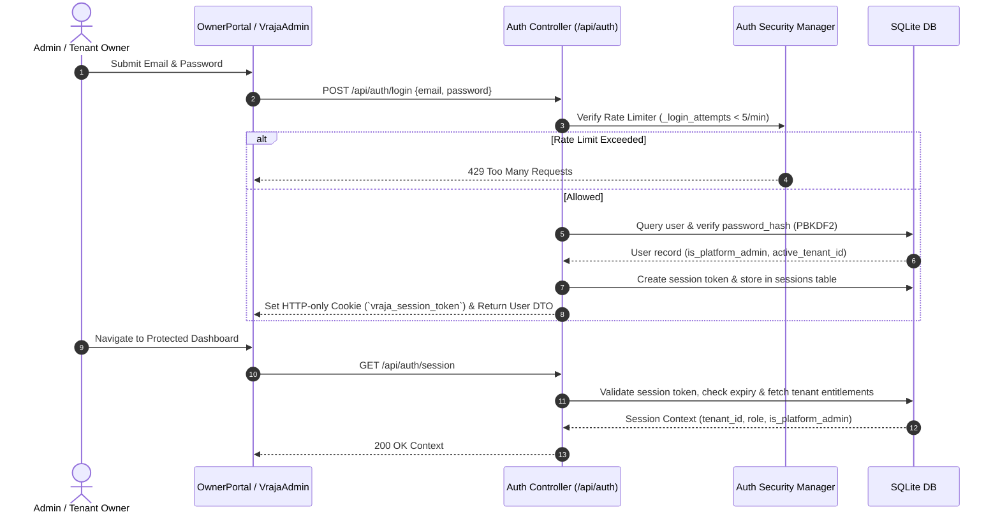

# Product A — Review System: Architecture & Workflows

## 1. System Architecture Overview

Product A (Review System) is a multi-tenant customer feedback, AI-assisted review generation, and Google Maps review acceleration platform. It connects on-premise diners/customers via QR codes to a dynamic, industry-templated web interface, and provides business owners and platform administrators with analytics and configuration capabilities.



---

## 2. Database Entity-Relationship (ER) Architecture

The persistence model is implemented in SQLite with `PRAGMA foreign_keys = ON` and `PRAGMA journal_mode = WAL`. Product A manages 11 core tables categorized into multi-tenant identity, telemetry, feedback tickets, and dynamic industry template governance.

```mermaid
erDiagram
    tenants ||--o{ tenant_memberships : "has members"
    users ||--o{ tenant_memberships : "belongs to"
    users ||--o{ sessions : "authenticates"
    tenants ||--o{ sessions : "scoped context"
    tenants ||--o{ analytics_events : "generates telemetry"
    tenants ||--o{ private_tickets : "receives feedback"
    tenants ||--o| business_configurations : "visual overrides"
    tenants ||--o{ business_template_assignments : "pinned template"
    
    industries ||--o{ templates : "categorizes"
    templates ||--o{ template_versions : "versions (draft/pub/arch)"
    template_versions ||--o{ business_template_assignments : "exact version pinned"

    tenants {
        string id PK "Unique tenant slug / ID"
        string business_name "Display name of business"
        string status "active / inactive"
        string platform "google / custom"
        string review_url "Google PlaceID review URL"
        string category "Industry category string"
        string primary_accent "Brand hex color"
        json topics_json "Default topics array"
        json entitlements_json "Allowed modules array"
        real created_at "Unix epoch timestamp"
        real updated_at "Unix epoch timestamp"
    }

    users {
        string id PK "User UUID"
        string email UK "User login email"
        string password_hash "PBKDF2/Argon2 hash"
        string display_name "Human readable name"
        int is_active "1 = active, 0 = disabled"
        int is_platform_admin "1 = superadmin, 0 = regular"
        real created_at "Timestamp"
        real updated_at "Timestamp"
    }

    tenant_memberships {
        string id PK "Membership UUID"
        string user_id FK "References users(id)"
        string tenant_id FK "References tenants(id)"
        string role "owner / manager / staff"
        real created_at "Timestamp"
    }

    sessions {
        string token_hash PK "SHA256 session token hash"
        string user_id FK "References users(id)"
        string active_tenant_id FK "References tenants(id)"
        real created_at "Created timestamp"
        real expires_at "Expiry timestamp"
        real revoked_at "Revocation timestamp"
    }

    analytics_events {
        string event_id PK "Event UUID"
        string tenant_id FK "Scoped tenant"
        json payload "Event payload details"
        real created_at "Event timestamp"
    }

    private_tickets {
        string ticket_id PK "Ticket UUID"
        string tenant_id FK "Scoped tenant"
        json payload "Feedback text, rating, status"
        real created_at "Created timestamp"
    }

    industries {
        string id PK "ind_restaurant, ind_hotel, etc."
        string slug UK "restaurant, hotel, salon, clinic"
        string name "Industry name"
        string icon "Visual unicode emoji"
        string status "active / archived"
        real created_at "Timestamp"
        real updated_at "Timestamp"
    }

    templates {
        string id PK "Unique template slug / ID"
        string industry_id FK "References industries(id)"
        string slug UK "URL-safe slug"
        string name "Template presentation title"
        string status "active / archived"
        real created_at "Timestamp"
        real updated_at "Timestamp"
    }

    template_versions {
        string id PK "ver_<slug>_<version>_<hash>"
        string template_id FK "References templates(id)"
        string version "Semantic version e.g. 1.0.0"
        json configuration_json "Full theme, layout, topics DTO"
        string schema_version "1.0"
        string publication_status "draft / published / archived"
        real published_at "Publish timestamp"
        real created_at "Timestamp"
        string created_by "Admin email"
    }

    business_template_assignments {
        string id PK "Assignment UUID"
        string business_id FK "References tenants(id)"
        string template_id FK "References templates(id)"
        string template_version_id FK "References template_versions(id)"
        string assigned_by "Admin email"
        real assigned_at "Timestamp"
        string status "active / superseded"
    }

    business_configurations {
        string id PK "Override UUID"
        string business_id UK FK "References tenants(id)"
        string logo_url "Custom logo URL"
        string cover_image_url "Custom cover URL"
        string primary_accent "Tenant accent HEX"
        json custom_topics_json "Custom topics array"
        json localized_content_json "Trilingual string overrides"
        string google_review_url "Custom Google review link"
        string status "active / disabled"
        real created_at "Timestamp"
        real updated_at "Timestamp"
    }
```

---

## 3. End-to-End Application Workflows

### 3.1 Customer Review Journey & Anti-Gating Review Handoff

The customer review flow is deliberately anti-gating compliant: whether a customer selects 1 star or 5 stars, Google Review handoff is never blocked or obscured.



---

### 3.2 AI Generation, Sentiment & Contradiction Filtering Workflow



---

### 3.3 Dynamic Template Lifecycle & Version Pinning Workflow



---

### 3.4 Multi-Tenant Authentication & Session Lifecycle


