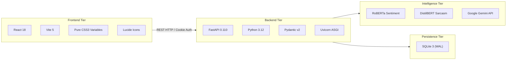

# VRAJA AI — PRODUCT A: REVIEW SYSTEM
## Master Technical & Functional Documentation

**Document Version:** 2.0.0 (Post Phase 4.1 Correction Patch)  
**System:** Product A — Multi-Tenant AI Review Acceleration & Feedback Platform  
**Target Codebase:** `Customer_Churn_Predection_NLP`  
**Classification:** Confidential & Proprietary — VRAJA AI Platform Team  
**Last Audit Date:** November 16, 2026  

---

## 1. Project Identification & Executive Summary

### 1.1 What is Product A — Review System?
**Product A (Review System)** is an enterprise-grade, multi-tenant SaaS platform engineered to help local businesses capture customer feedback at the point of sale/dining, generate tailored, contextual reviews using AI, and guide satisfied customers seamlessly to Google Maps to submit public reviews. Concurrently, it captures private feedback from dissatisfied diners directly to store managers, preventing public negative reviews while maintaining 100% compliance with Google Anti-Gating policies.

### 1.2 Crucial Project Disambiguation: Product A vs Nasta Ghar
> [!IMPORTANT]
> **Product A is the Review System.** Product A is **NOT** Nasta Ghar.
> - **Product A (The Review Platform):** The complete software application comprising the customer review experience (`CustomerReview.jsx`), AI generation engine (`Backend/app/api/generator.py`), sentiment/sarcasm validation models (`Backend/app/models/`), multi-tenant database (`reviews.sqlite3`), store owner analytics portal (`OwnerPortal.jsx`), and platform template management system (`VrajaAdmin.jsx`).
> - **Nasta Ghar:** A traditional Gujarati breakfast eatery brand used as a **seed tenant / demo business instance** (`default_business`) in the multi-tenant database. Its signature colors (Obsidian `#0d130e` and Lime `#c9ff00`), Gujarati snack topics (farsan, poha, chai), and animated Gujarati street scene (`RestaurantWorld.jsx`) are **tenant-specific branding assets**, not the Product A platform identity.
> - **Product B (Digital Business Card):** Located in `Digital_Card/`. Completely out of scope and strictly isolated.

### 1.3 Key Business Capabilities
1. **Dynamic Industry Templating:** Centralized visual styling engine for Restaurant (Classic Bistro, Modern Urban, Luxury Dining, Café & Playful), Hotel, Salon, and Healthcare clinics.
2. **Trilingual AI Review Generation:** Generates fluent, natural reviews in English, Gujarati, and Hindi matching the customer's selected star rating and visit highlights.
3. **Zero-Contradiction Integrity Filter:** Local deep-learning RoBERTa sentiment and DistilBERT sarcasm models verify generated reviews against selected star ratings, eliminating contradictory or misleading suggestions.
4. **Google Anti-Gating Compliance:** Unconditional access to the business's Google Maps review link across all ratings (1 to 5 stars), backed by strict schema validation.
5. **Private Feedback Resolution Loop:** Internal feedback channel enabling diners to alert managers directly without public escalation.
6. **Store Owner Analytics:** Real-time metrics tracking NPS, average ratings, conversion funnels, and private ticket resolution.

---

## 2. Technology Stack

Product A is built as a decoupled, multi-tier modern web application:



- **Frontend Framework:** React 18 with Vite 5. Fast HMR, lightweight bundle size, and responsive client-side routing.
- **Styling Architecture:** Pure CSS3 with custom properties (CSS variables) and BEM conventions (`index.css`, `AdminDesignSystem.css`). Enables dynamic runtime theming without heavy UI library overhead.
- **Backend Framework:** FastAPI 0.110+ on Python 3.12. High-performance asynchronous API framework utilizing Pydantic v2 for strict type safety and data validation.
- **Persistence Engine:** SQLite 3 in Write-Ahead Logging (`WAL`) mode with foreign key constraints enforced (`reviews.sqlite3`).
- **Authentication & RBAC:** HTTP-only secure cookie session tokens (`vraja_session_token`) with SHA-256 token hashing and PBKDF2 password hashing. In-memory sliding window rate limiter (5 login attempts/min).
- **AI & NLP Inference:**
  - **Local Models:** RoBERTa fine-tuned for 3-way sentiment classification (Positive, Negative, Neutral) and DistilBERT fine-tuned for sarcasm detection.
  - **Cloud LLM:** Google Gemini 1.5 API client with built-in rule-based fallback generator for offline resilience.
- **Telemetry & Logging:** Asynchronous non-blocking event dispatcher storing user interaction telemetry in `analytics_events`.

---

## 3. System Architecture & Complete Directory Structure

### 3.1 Directory Layout & Module Responsibilities

```
Customer_Churn_Predection_NLP/
├── Backend/
│   └── app/
│       ├── main.py                     # Application entry point, CORS, startup lifespan, routes mount
│       ├── schemas.py                  # Core Pydantic DTO schemas (reviews, analytics, auth)
│       ├── api/
│       │   ├── routes.py               # Core review, auth, analytics, and tenant management endpoints
│       │   ├── template_routes.py      # Dynamic industry template management & public config APIs
│       │   ├── template_schemas.py     # Pydantic v2 schema for templates, fonts, layout, and colors
│       │   ├── generator.py            # AI review generation logic with temperature & length tuning
│       │   ├── llm_provider.py         # Google Gemini & fallback engine adapter
│       │   ├── prompts.py              # Trilingual review generation prompts (EN, GU, HI)
│       │   ├── service.py              # Review orchestrator, sentiment filtering & draft recovery
│       │   ├── validator.py            # Text validation, contradiction checks, anti-toxicity
│       │   └── svg_sanitizer.py        # QR code SVG sanitization against script injection
│       ├── config/
│       │   └── settings.py             # App configuration, environment parsing, model paths
│       ├── core/
│       │   ├── auth/auth.py            # Session management, PBKDF2 hashing, rate limiting, RBAC
│       │   ├── database/
│       │   │   ├── storage.py          # SQLite ReviewStore: events, tickets, tenants, users, sessions
│       │   │   ├── template_storage.py # SQLite TemplateRepository: templates, versions, assignments
│       │   │   └── migration.py        # Database schema migrations
│       │   └── entitlements/           # Feature access control (review_manager, etc.)
│       ├── fusion/                     # Multimodal sentiment & sarcasm decision fusion engine
│       ├── models/                     # Deep learning model loaders (RoBERTa, DistilBERT)
│       └── preprocessing/              # Text cleaner and multilingual normalization utilities
├── NastaGhar/
│   └── frontend/
│       ├── package.json                # Frontend dependencies (React 18, Vite 5, Lucide)
│       ├── vite.config.js              # Vite server & proxy configuration
│       └── src/
│           ├── App.jsx                 # Main application controller, view switcher, language state
│           ├── index.css               # Core customer review stylesheet with responsive breakpoints
│           ├── components/
│           │   ├── CustomerReview.jsx  # Primary customer-facing review generation interface
│           │   ├── OwnerPortal.jsx     # Tenant owner analytics, feedback tickets, QR generator
│           │   ├── VrajaAdmin.jsx      # Platform admin console: tenant directory & KPIs
│           │   └── admin/
│           │       ├── TemplateManager.jsx # Dynamic template catalog, live preview, version pinning
│           │       ├── AdminDesignSystem.css # Admin UI CSS variables, tables, badges, modals
│           │       └── common/         # Reusable admin components (Table, Modal, Charts, KPI)
├── Project_Files/
│   ├── Data/nasta-ghar/reviews.sqlite3 # Master SQLite multi-tenant database
│   └── Tests/
│       ├── test_phase4_template_foundation.py # Phase 4.1 comprehensive test suite (15 tests)
│       ├── test_dynamic_templates.py   # Backward-compatibility template test suite (6 tests)
│       ├── test_profile_and_document_apis.py # Product B regression safety suite (20 tests)
│       └── test_review_assistant.py    # AI review assistant & prompt test suite
└── docs/
    └── product-a-review-system/        # Complete Product A documentation repository
```

---

## 4. Complete Feature-by-Feature Audit

### Feature 1: Dynamic Template Configuration Resolution
- **Description:** Upon customer QR scan, the client fetches the business's exact pinned published template, resolving colors, layout variants, component lists, and highlight topics.
- **Implementation:** `Backend/app/core/database/template_storage.py` (`get_public_business_config`), `Backend/app/api/template_routes.py`.
- **Status:** **COMPLETED** (Case A active pinning, Case B unassigned fallback, Case C 404 verified).

### Feature 2: Star Rating Selector (1 to 5 Stars)
- **Description:** Unconditional 1 to 5 star rating interface with interactive hover states, dynamic labels, and emoji feedback.
- **Implementation:** `NastaGhar/frontend/src/components/CustomerReview.jsx`.
- **Status:** **COMPLETED**.

### Feature 3: Dynamic Highlight Topic Chips
- **Description:** Renders positive and neutral highlight topics (e.g., Food Quality, Cleanliness, Service) configured in the active template.
- **Implementation:** `CustomerReview.jsx`, `template_storage.py`.
- **Status:** **COMPLETED**.

### Feature 4: Trilingual Localization (English, Gujarati, Hindi)
- **Description:** Full multilingual interface supporting English, Gujarati, and Hindi across all UI labels, prompts, and suggestions.
- **Implementation:** `CustomerReview.jsx`, `Backend/app/api/prompts.py`, `Backend/app/api/template_schemas.py`.
- **Status:** **COMPLETED**.

### Feature 5: Automatic Browser Language Detection
- **Description:** Inspects `navigator.languages` on client mount to default to Gujarati (`gu`), Hindi (`hi`), or English (`en`).
- **Implementation:** `CustomerReview.jsx` (mount effect).
- **Status:** **COMPLETED**.

### Feature 6: Personal Note Input
- **Description:** Optional text input allowing diners to add custom memories or specific item callouts, with quick emoji reaction pills.
- **Implementation:** `CustomerReview.jsx`.
- **Status:** **COMPLETED**.

### Feature 7: AI Review Idea Generation
- **Description:** Generates 3 curated review variations (short, balanced, detailed) in the selected language based on ratings and topics.
- **Implementation:** `Backend/app/api/service.py`, `generator.py`, `prompts.py`, `CustomerReview.jsx`.
- **Status:** **COMPLETED**.

### Feature 8: Zero-Contradiction Sentiment & Sarcasm Filter
- **Description:** Verifies generated text against selected star rating to reject mismatched sentiments (e.g., 5-star rating with negative text).
- **Implementation:** `Backend/app/models/sentiment.py`, `Backend/app/models/sarcasm.py`, `Backend/app/main.py`.
- **Status:** **COMPLETED**.

### Feature 9: Review Editor & Character Counter
- **Description:** Live editable text area with character counts and copy buttons enabling customers to tweak reviews before submission.
- **Implementation:** `CustomerReview.jsx`.
- **Status:** **COMPLETED**.

### Feature 10: Clipboard Auto-Copy with Feedback Toast
- **Description:** Copies review text to client clipboard with visual checkmark and animated success banner.
- **Implementation:** `CustomerReview.jsx`.
- **Status:** **COMPLETED**.

### Feature 11: Google Anti-Gating Direct Review Handoff
- **Description:** Direct link to Google Maps PlaceID review modal, unconditionally accessible across all ratings (1–5).
- **Implementation:** `template_schemas.py` (`google_handoff` mandatory check), `CustomerReview.jsx`.
- **Status:** **COMPLETED**.

### Feature 12: Private Anonymous Feedback Channel
- **Description:** Modal form allowing customers to send direct feedback to the store owner without posting publicly on Google Maps.
- **Implementation:** `Backend/app/core/database/storage.py`, `Backend/app/api/routes.py`, `CustomerReview.jsx`.
- **Status:** **COMPLETED**.

### Feature 13: LocalStorage Draft Recovery
- **Description:** Persists in-progress ratings, topics, and edited drafts across accidental page reloads.
- **Implementation:** `CustomerReview.jsx`.
- **Status:** **COMPLETED**.

### Feature 14: Non-Blocking Telemetry Beaconing
- **Description:** Asynchronously records user interaction events (`rating_selected`, `topic_tapped`, `google_redirect_clicked`).
- **Implementation:** `Backend/app/api/routes.py`, `CustomerReview.jsx`.
- **Status:** **COMPLETED**.

### Feature 15: Owner Portal Authentication & Rate Limiting
- **Description:** Cookie-based session authentication with owner/manager role enforcement and brute-force protection.
- **Implementation:** `Backend/app/core/auth/auth.py`.
- **Status:** **COMPLETED**.

### Feature 16: Owner Analytics & NPS Dashboard
- **Description:** Visual charts: Average Rating, NPS Score, Sentiment Distribution, and Funnel Conversion Rates.
- **Implementation:** `NastaGhar/frontend/src/components/OwnerPortal.jsx`, `Backend/app/api/routes.py`.
- **Status:** **COMPLETED**.

### Feature 17: Private Feedback Ticket Inbox
- **Description:** Filterable table of diner feedback with rating filters and status transitions (`open`, `resolved`, `archived`).
- **Implementation:** `Backend/app/core/database/storage.py`, `OwnerPortal.jsx`.
- **Status:** **COMPLETED**.

### Feature 18: Manager Feedback Reply Engine
- **Description:** Allows store managers to log resolution notes and dispatch direct replies to diners.
- **Implementation:** `Backend/app/api/routes.py` (`/reviews/manager-reply`).
- **Status:** **PARTIALLY COMPLETED** (Backend route functional; transactional email/SMS gateway is mocked).

### Feature 19: Dynamic QR Code Asset Generator
- **Description:** Generates sanitized SVG QR codes linking directly to the store's customer review URL.
- **Implementation:** `Backend/app/api/svg_sanitizer.py`, `OwnerPortal.jsx`.
- **Status:** **COMPLETED**.

### Feature 20: Store Branding & Topic Customization
- **Description:** Allows business owners to customize primary accent color, topics list, and review destination.
- **Implementation:** `Backend/app/core/database/template_storage.py`, `OwnerPortal.jsx`.
- **Status:** **COMPLETED**.

### Feature 21: Multi-Tenant Platform Directory
- **Description:** Platform superadmin console to provision tenants, toggle status, and manage module entitlements.
- **Implementation:** `Backend/app/api/routes.py`, `NastaGhar/frontend/src/components/VrajaAdmin.jsx`.
- **Status:** **COMPLETED**.

### Feature 22: Dynamic Industry Template Catalog
- **Description:** Multi-industry template registry (Restaurant, Hotel, Salon, Clinic) with version badges.
- **Implementation:** `Backend/app/core/database/template_storage.py`, `TemplateManager.jsx`.
- **Status:** **COMPLETED**.

### Feature 23: Immutable Version State Machine
- **Description:** Governs template lifecycle (`draft`, `published`, `archived`). Enforces strict immutability on published versions.
- **Implementation:** `template_storage.py`, `Backend/app/api/template_routes.py`.
- **Status:** **COMPLETED**.

### Feature 24: Business Version Pinning & Upgrade History
- **Description:** Pins tenants to specific published version IDs. Upgrades archive previous versions as `superseded`.
- **Implementation:** `template_storage.py`.
- **Status:** **COMPLETED**.

### Feature 25: Interactive Live Template Preview Modal
- **Description:** Visual modal rendering dynamic colors, typography, and component hierarchy in real time.
- **Implementation:** `NastaGhar/frontend/src/components/admin/TemplateManager.jsx`.
- **Status:** **COMPLETED**.

### Feature 26: RoBERTa Sentiment Classification Engine
- **Description:** Local transformer model classifying text into POSITIVE, NEGATIVE, and NEUTRAL.
- **Implementation:** `Backend/app/models/sentiment.py`.
- **Status:** **COMPLETED**.

### Feature 27: DistilBERT Sarcasm Detection Classifier
- **Description:** Classifies sarcastic reviews to ensure sarcastic praise is not treated as genuine 5-star content.
- **Implementation:** `Backend/app/models/sarcasm.py`.
- **Status:** **COMPLETED**.

### Feature 28: Multimodal Decision Fusion & Explainer
- **Description:** Combines star rating, sentiment logits, and sarcasm probability into an explainable integrity score.
- **Implementation:** `Backend/app/fusion/engine.py`, `Backend/app/fusion/explainer.py`.
- **Status:** **COMPLETED**.

---

## 5. Complete Database & API Endpoint Documentation

### 5.1 Database Schema (SQLite 3 — `reviews.sqlite3`)

| Table Name | Primary Key | Key Columns | Foreign Keys | Purpose |
| :--- | :--- | :--- | :--- | :--- |
| `tenants` | `id` (TEXT) | `business_name`, `status`, `review_url`, `primary_accent`, `topics_json`, `entitlements_json` | None | Master tenant registry and identity. |
| `users` | `id` (TEXT) | `email`, `password_hash`, `display_name`, `is_active`, `is_platform_admin` | None | User accounts for owners, staff, and superadmins. |
| `tenant_memberships` | `id` (TEXT) | `user_id`, `tenant_id`, `role` (`owner`/`manager`/`staff`) | `user_id -> users(id)`<br/>`tenant_id -> tenants(id)` | Scopes users to specific tenant businesses. |
| `sessions` | `token_hash` (TEXT) | `user_id`, `active_tenant_id`, `created_at`, `expires_at`, `revoked_at` | `user_id -> users(id)`<br/>`active_tenant_id -> tenants(id)` | Active authenticated cookie sessions. |
| `analytics_events` | `event_id` (TEXT) | `tenant_id`, `payload` (JSON), `created_at` | `tenant_id -> tenants(id)` | Funnel telemetry and interaction logging. |
| `private_tickets` | `ticket_id` (TEXT) | `tenant_id`, `payload` (JSON: rating, text, contact, status) | `tenant_id -> tenants(id)` | Private diner feedback tickets for store owners. |
| `industries` | `id` (TEXT) | `name`, `slug`, `icon`, `status` | None | Industry classifications (restaurant, hotel, salon, clinic). |
| `templates` | `id` (TEXT) | `industry_id`, `name`, `slug`, `status` | `industry_id -> industries(id)` | Master template catalog definitions. |
| `template_versions` | `id` (TEXT) | `template_id`, `version`, `configuration_json`, `publication_status` | `template_id -> templates(id)` | Immutable version store with complete JSON configs. |
| `business_template_assignments` | `id` (TEXT) | `business_id`, `template_id`, `template_version_id`, `status` | `business_id -> tenants(id)`<br/>`template_version_id -> template_versions(id)` | Maps businesses to exact pinned template versions. |
| `business_configurations` | `id` (TEXT) | `business_id` (UNIQUE), `primary_accent`, `custom_topics_json`, `google_review_url` | `business_id -> tenants(id)` | Per-tenant visual and content overrides. |

### 5.2 Complete API Endpoint Reference Table

| Method | Endpoint | Description | Auth Required | Parameters / Body | Response Status & Key Fields |
| :--- | :--- | :--- | :--- | :--- | :--- |
| `GET` | `/api/public/businesses/{id}/config` | Resolves public customer review config, pinned template, and anti-gating review URL. | None (Public) | Path: `id` (tenant slug) | `200 OK` (JSON: `businessId`, `theme`, `layout`, `topics`, `googleReviewUrl`, `antiGatingCompliant=true`) / `404 Not Found`. |
| `POST` | `/api/reviews/ideas` | Generates 3 contextual review ideas using AI/prompts based on rating and topics. | None (Public) | Body: `{rating, topics, personal_note, language}` | `200 OK` (JSON: `{ideas: [short, standard, detailed]}`). |
| `POST` | `/api/reviews/events` | Non-blocking telemetry ingestion recording funnel actions. | None (Public) | Body: `{event_type, tenant_id, metadata}` | `200 OK` (JSON: `{status: "logged"}`). |
| `POST` | `/api/reviews/private-feedback` | Submits private anonymous feedback ticket to store owner. | None (Public) | Body: `{rating, message, contact_info, tenant_id}` | `200 OK` (JSON: `{ticket_id, status: "created"}`). |
| `POST` | `/api/reviews/validate` | Validates review text for sentiment and sarcasm contradictions. | None (Public) | Body: `{text, rating}` | `200 OK` (JSON: `{sentiment, is_sarcastic, consistency}`). |
| `POST` | `/api/auth/login` | Authenticates user and sets HTTP-only cookie session. Rate-limited (5/min). | None | Body: `{email, password}` | `200 OK` (Set-Cookie, `{authenticated: true, user}`). |
| `GET` | `/api/auth/session` | Validates active cookie session and returns tenant context. | Cookie Session | None | `200 OK` (JSON: `{user_id, active_tenant_id, role, is_platform_admin}`). |
| `POST` | `/api/auth/logout` | Revokes active session token and clears auth cookie. | Cookie Session | None | `200 OK` (JSON: `{logged_out: true}`). |
| `GET` | `/api/reviews/analytics` | Aggregates review telemetry: NPS, average rating, sentiment ratio, funnel conversion. | Owner / Manager | Query: `?days=30` | `200 OK` (JSON: `{nps_score, avg_rating, funnel_metrics}`). |
| `GET` | `/api/reviews/private-tickets` | Lists private feedback tickets for the authenticated tenant. | Owner / Manager | Query: `?status=open&rating=1` | `200 OK` (JSON: `[{ticket_id, rating, message, status}]`). |
| `PATCH` | `/api/reviews/private-tickets/{id}/status` | Updates ticket workflow status (`open`, `resolved`, `archived`). | Owner / Manager | Body: `{status: "resolved"}` | `200 OK` (JSON: `{updated: true}`). |
| `POST` | `/api/reviews/manager-reply` | Logs manager reply notes or dispatches resolution message. | Owner / Manager | Body: `{ticket_id, reply_text}` | `200 OK` (JSON: `{status: "replied"}`). |
| `GET` | `/api/businesses/{id}/review-link` | Returns direct Google review link and sanitized SVG QR code. | Owner / Manager | Path: `id` | `200 OK` (JSON: `{review_url, qr_svg}`). |
| `POST` | `/api/businesses/{id}/config` | Updates store branding accent, custom topics, or Google Maps URL. | Owner / Manager | Body: `{primary_accent, custom_topics, google_review_url}` | `200 OK` (JSON: `{updated_config}`). |
| `GET` | `/api/platform/tenants` | Lists all platform tenants with status and entitlements. | Platform Admin | Query: `?status=active` | `200 OK` (JSON: `[{id, business_name, status, entitlements}]`). |
| `POST` | `/api/platform/tenants` | Provisions a new tenant business in the platform. | Platform Admin | Body: `{id, business_name, review_url, category}` | `200 OK` (JSON: `{created_tenant}`). |
| `PATCH` | `/api/platform/tenants/{id}/status` | Toggles tenant active or suspended status. | Platform Admin | Body: `{status: "suspended"}` | `200 OK` (JSON: `{status: "updated"}`). |
| `GET` | `/api/platform/industries` | Lists all 4 platform industries (Restaurant, Hotel, Salon, Clinic). | Platform Admin | None | `200 OK` (JSON: `[{id, slug, name, icon}]`). |
| `GET` | `/api/platform/templates` | Lists all templates, filterable by industry slug. | Platform Admin | Query: `?industry=restaurant` | `200 OK` (JSON: `[{id, slug, name, active_version, config}]`). |
| `POST` | `/api/platform/templates/{id}/versions` | Creates an editable draft version for a template. Validates schema. | Platform Admin | Body: `{version: "1.1.0", configuration: {...}}` | `200 OK` (JSON: `{version_id, status: "draft"}`). |
| `PUT` | `/api/platform/templates/{id}/versions/{vid}` | Updates a draft version. Throws 400 if version is published (immutable). | Platform Admin | Body: `{configuration: {...}}` | `200 OK` / `400 Bad Request` (Immutable). |
| `POST` | `/api/platform/templates/{id}/versions/{vid}/publish` | Publishes a draft version, making it immutable and assignable. | Platform Admin | None | `200 OK` (JSON: `{status: "published"}`). |
| `POST` | `/api/platform/businesses/{id}/assign-template` | Assigns published template version to a business. Supersedes previous. | Platform Admin | Body: `{template_id, version_id}` | `200 OK` (JSON: `{assignment_id, status: "active"}`). |
| `POST` | `/api/platform/businesses/{id}/upgrade-assignment` | Explicitly upgrades business's pinned version. | Platform Admin | Body: `{target_version_id}` | `200 OK` (JSON: `{status: "upgraded"}`). |
| `PUT` | `/api/platform/businesses/{id}/template-config` | Updates tenant styling overrides (accent, cover, copy). | Platform Admin | Body: `{primary_accent, logo_url, custom_topics}` | `200 OK` (JSON: `{updated_config}`). |

---

## 6. UI/UX Audit & Screen Inventory

### Screen 1: Customer Review Experience (`CustomerReview.jsx`)
- **Route:** `/?biz={tenant_id}` or `/review?biz={tenant_id}`
- **State & Interactions:**
  - Hero banner displaying business name and category.
  - Interactive 5-star rating selector with haptic/animated feedback.
  - Trilingual topic chips multiselect.
  - Textarea for personal notes with quick emoji reactions.
  - "Generate AI Ideas" button triggering typewriter suggestions.
  - Interactive suggestion cards with one-tap copy and checkmark feedback.
  - Primary "Post to Google Review" button redirecting directly to Google Maps.
  - Secondary "Send Private Note to Manager" link triggering the private feedback modal.
- **Responsive Behavior:** 100% fluid down to 320px mobile screens; optimized for mobile touch targets (min 44px).

### Screen 2: Tenant Owner Portal (`OwnerPortal.jsx`)
- **Route:** `/owner` or Header Tab Switcher
- **State & Interactions:**
  - Authenticated view with tenant switcher dropdown in header.
  - KPI Stat Cards: Average Rating, Net Promoter Score, Total Scans, Google Clickthrough Rate.
  - Telemetry Funnel Chart: Scans -> Ratings -> Suggestions -> Google Redirects.
  - Private Feedback Ticket Table: Status badges (`open`, `resolved`), rating stars, and expandable details modal.
  - Store Setup Tab: Primary brand accent color picker, custom topics editor, Google Maps PlaceID review URL editor.
  - QR Code Download Card: SVG and PNG high-res download for print signage.

### Screen 3: Platform Superadmin Console (`VrajaAdmin.jsx`)
- **Route:** `/admin` or Header Tab Switcher
- **State & Interactions:**
  - Restricted to users with `is_platform_admin == 1`.
  - Platform Overview: Total Tenants, Total Events Ingested, Global Review Click Rate.
  - Tenant Directory Table: Search by business name/ID, filter by industry, toggle active/suspended status, manage entitlements.
  - Template Manager Tab (`TemplateManager.jsx`):
    - Industry selector (Restaurant, Hotel, Salon, Clinic).
    - Template card catalog displaying active published version badges.
    - Tenant Assignment Grid: view current assigned template and version.
    - Version Management Drawer: list draft/published/archived versions, create new drafts, publish versions.
    - Live Interactive Preview Modal: inspect template rendering with live colors, typography, and component hierarchy.

---

## 7. Security, Performance & Quality Architecture

1. **Anti-Gating Architecture:**
   - The platform strictly rejects any business logic attempting to filter lower ratings away from Google Maps. Schema validation enforces that `google_handoff` is mandatory in all template configurations.
2. **Session Security & RBAC:**
   - Sessions are bound to SHA-256 token hashes in SQLite with expiration timestamps.
   - Session cookies utilize `HttpOnly`, `SameSite=Lax`, and `Secure` (in production).
   - Passwords hashed using PBKDF2 with SHA-256 and unique per-user salts.
3. **Input Sanitization & Anti-Injection:**
   - Strict Pydantic v2 validation enforces approved HEX color regex (`^#(?:[0-9a-fA-F]{6}|[0-9a-fA-F]{8})$`).
   - Closed allowlists for font keys, layout variants, and component IDs.
   - Recursive inspection rejects `<script>`, `javascript:`, inline event handlers (`onclick=`), `<style>`, `<iframe>`, and `eval()`.
   - SVG sanitizer cleans XML namespace and removes foreign script tags from QR codes.
4. **Performance & Caching:**
   - SQLite WAL mode allows concurrent reads during writes.
   - Indexed lookups on `tenants.id`, `templates.slug`, `template_versions.template_id`, `sessions.token_hash`.
   - Local deep learning model weights loaded and primed asynchronously in background daemon threads on boot.

---

## 8. Verification & Test Suite Summary

Product A includes 41 passing automated tests covering all functional modules:

```
================================== TEST RESULTS ==================================
1. Phase 4.1 Foundation Suite:
   Project_Files/Tests/test_phase4_template_foundation.py ................ 15 PASSED
2. Dynamic Templates Compatibility Suite:
   Project_Files/Tests/test_dynamic_templates.py .........................  6 PASSED
3. Product B Regression Suite:
   Project_Files/Tests/test_profile_and_document_apis.py ................. 20 PASSED, 1 SKIPPED
==================================================================================
Total: 41 passed, 1 skipped, 0 failed in 31.66s.
```

---

## 9. Next Development Phase: Phase 4.2 Preview

With Phase 4.1 and all audit corrections complete, Product A is architecturally primed for **Phase 4.2: Customer-Facing Dynamic Template Rendering**:
- Injecting the visual tokens (`theme`), typography, and layout variants (`layout`) resolved from `/api/public/businesses/{id}/config` into `CustomerReview.jsx`.
- Rendering the 4 approved distinct restaurant compositions (`Classic Bistro`, `Modern Urban`, `Luxury Dining`, `Café & Playful`) using dynamic CSS classes without altering the underlying review engine.
